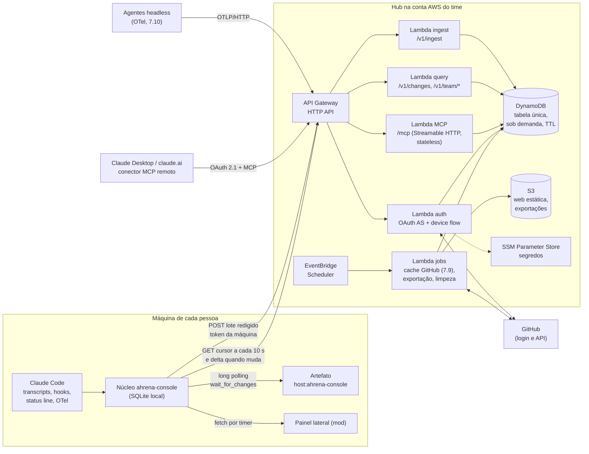

# 0002 · Arquitetura e custo do hub AWS

- **Status:** aceita
- **Data:** 2026-10-18
- **Issue:** [#47](https://github.com/ahrenatechnology/ahrena-console/issues/47) (spike 7.1 do [backlog](../backlog-0.0.1.md), épico [#8](https://github.com/ahrenatechnology/ahrena-console/issues/8))
- **Destrava:** 7.2 a 7.11 (em especial [#48](https://github.com/ahrenatechnology/ahrena-console/issues/48) e [#49](https://github.com/ahrenatechnology/ahrena-console/issues/49))

> Estudo e desenho. Nenhum recurso foi criado na AWS e nenhuma credencial foi usada. Os preços são os de tabela de `us-east-1` conhecidos em 2026: confira na calculadora da AWS antes da 7.3.

## Contexto

A 0.0.1 é local-first: um núcleo por máquina coleta as sessões do Claude Code, guarda em SQLite e expõe por MCP em localhost ([proposta](../proposta-0.0.1.md), seções 1 e 2). Em novembro de 2026 o time passa a usar o console em conjunto: analistas e agentes remotos, em lugares e horários diferentes, precisam ver as sessões e o trabalho uns dos outros. Isso exige um ponto central, o **hub**.

O que o hub precisa respeitar:

- **O mesmo código.** O núcleo fica atrás de portas; o hub troca os adaptadores (armazenamento, identidade), não a lógica. A porta de armazenamento nasce na [#11](https://github.com/ahrenatechnology/ahrena-console/issues/11), em paralelo a este spike.
- **A máquina envia, o hub nunca busca.** A sincronização é opcional e explícita, e o que sai é decidido na máquina (7.6).
- **Muito barato.** Um time pequeno não pode pagar um servidor parado. O custo tem que acompanhar o uso e ficar em poucos dólares para 5 pessoas.
- **As mesmas superfícies.** Painel lateral (mod), artefato e MCP. Das validações ([validacoes-0.0.1.md](../validacoes-0.0.1.md)) vêm dois limites que pesam aqui: a ponte `host:` dos artefatos só enxerga servidores do Claude Desktop, e o `watchTool` tem piso de 30 s, contornado com long polling.
- **Open source.** Cada time sobe o hub na própria conta AWS. Nada de conta, nome ou infraestrutura de quem mantém o projeto.

## Decisão

**Hub serverless em AWS: API Gateway HTTP API + Lambda (Node 24, arm64), DynamoDB sob demanda em tabela única, S3 para estáticos e exportações, EventBridge Scheduler para tarefas periódicas, login com GitHub (GitHub App) e o próprio hub como servidor de autorização OAuth do conector MCP remoto. Tempo real por polling curto de um cursor, feito pelo núcleo local, que oferece long polling às superfícies. Infraestrutura em AWS CDK (TypeScript).**

### Componentes e fluxo

**Ida (agente local → hub).** O núcleo junta os eventos novos, aplica a redação de segredos e o filtro do que pode sair (7.6) e manda um lote comprimido a cada 10 s enquanto há atividade (`POST /v1/ingest`, com versão do esquema no corpo). O Lambda de ingestão valida o token da máquina, grava de forma idempotente (chave `message.id` + `requestId`, a mesma do coletor local), atualiza o resumo da sessão e os agregados de uso, e incrementa o **cursor do time**. O padrão é mandar só metadados, estado e uso; o conteúdo das mensagens só vai se a pessoa ligar.

**Volta (hub → superfícies).**

- **Artefato e painel:** continuam falando só com o núcleo local, que é o caminho validado (V2). No modo hub, o núcleo consulta `GET /v1/changes?cursor=…` a cada 10 s, baixa o delta quando o cursor muda, guarda no SQLite como cache da visão do time e responde o `wait_for_changes` do artefato na hora. Assim o artefato tem atualização quase instantânea sem segurar conexão na AWS.
- **MCP remoto (7.7):** o hub expõe `/mcp` com as mesmas ferramentas do épico 2, para quem usa o Claude sem núcleo local (um gestor no claude.ai, um agente remoto). É pedido e resposta, sem tempo real.
- **Headless (7.10):** OTLP/HTTP direto no hub, com token de máquina do tipo "serviço".

**EventBridge** entra pelo **Scheduler**: atualizar o cache do GitHub para o time (7.9), exportar a tabela para o S3 e varrer máquinas que pararam de reportar (7.11). Um barramento de eventos próprio só entra quando houver um consumidor (por exemplo, alertas); hoje ele seria peça sem uso.

**S3** guarda a UI web estática (admin e console fora do Claude, servidos por CloudFront dentro da cota grátis) e as exportações da tabela. **Não** guarda cada lote bruto: a 1 PUT por lote, isso custaria mais que o DynamoDB inteiro para 5 pessoas (US$ 0,005 por mil PUTs × 63 mil lotes por pessoa por mês ≈ US$ 0,32 por pessoa).

### Modelo de tabelas no DynamoDB

Tabela única, sob demanda, com TTL e PITR. Toda chave começa pelo time (`T#<team>`), que vem **do token**, nunca do pedido.

| Item | PK | SK | Atributos principais | TTL |
| --- | --- | --- | --- | --- |
| Time | `T#<team>` | `TEAM` | nome, orgs do GitHub permitidas, plano de visibilidade | — |
| Pessoa | `T#<team>` | `U#<githubId>` | login, papel (`owner`, `admin`, `member`), ativo | — |
| Máquina | `T#<team>` | `M#<machineId>` | dono, versão do reporter, último envio | — |
| Projeto | `T#<team>` | `PRJ#<projectId>` | repositório, pasta, cliente | — |
| Cursor | `T#<team>` | `CURSOR` | `version` (contador atômico) | — |
| Sessão | `T#<team>#S#<sessionId>` | `META` | pessoa, máquina, projeto, cliente, `origin`, estado, custo, `updatedAt`, `version` | 90 dias depois do fim |
| Agente | `T#<team>#S#<sessionId>` | `A#<agentId>` | pai, tipo, estado | idem |
| Bloco de eventos | `T#<team>#S#<sessionId>` | `E#<tsInicio>#<loteId>` | eventos do lote, compactados (≈250 B por evento) | 90 dias |
| Uso | `T#<team>#S#<sessionId>` | `U#<modelo>` | tokens por tipo, incluindo cache | idem |
| Plano | `T#<team>#S#<sessionId>` | `PLAN` | passos e dono | idem |
| Agregado diário | `T#<team>#D#<aaaa-mm-dd>` | `P#<pessoa>#PRJ#<projeto>#M#<modelo>` | tokens e custo (`ADD` atômico) | 400 dias |
| Limites | `T#<team>` | `LIM#<pessoa>` | último `LimitSnapshot` com procedência | — |
| Admin | `T#<team>` | `CFG#prices`, `CFG#flags`, `CFG#notices` | tabela de preços, chaves de recursos, avisos | — |
| Log do admin | `T#<team>#AUDIT` | `<ts>#<id>` | quem, o quê | 400 dias |
| Token | `TOK#<sha256>` | `TOK` | tipo (máquina, serviço, sessão OAuth), time, pessoa, máquina, revogado | expira |

Índices globais (projeção só de chaves e atributos da lista):

| Índice | PK | SK | Responde |
| --- | --- | --- | --- |
| GSI1 · sessões do time | `T#<team>` | `<updatedAt>#<sessionId>` | mural, kanban, "quem precisa de você", delta por cursor |
| GSI2 · por dimensão | `T#<team>#P#<pessoa>`, `T#<team>#M#<máquina>` ou `T#<team>#C#<cliente>` (sobrecarregado) | `<updatedAt>#<sessionId>` | visão por pessoa, máquina e cliente (7.8) |

Escolhas que seguram o custo: os eventos de um lote viram **um item** por sessão (escrever cada evento à parte quadruplicaria as escritas e o armazenamento); o resumo da sessão é atualizado uma vez por lote, não por evento; e os agregados de custo são pré-calculados por dia, porque o DynamoDB não faz `GROUP BY`.

### Encaixe na porta de armazenamento da #11

O hub não depende do código da #11; depende de três propriedades da porta, que recomendamos fixar lá:

1. **Escopo explícito.** Toda operação recebe o escopo (`team`) num contexto. O SQLite local usa um time fixo (`local`); o adaptador DynamoDB usa o do token.
2. **Paginação por cursor opaco**, não por `OFFSET`. O SQLite codifica `(updatedAt, id)`; o DynamoDB codifica o `LastEvaluatedKey`.
3. **Consultas nomeadas pelo caso de uso**, não SQL livre: `appendEvents(lote)` idempotente, `listSessions(filtro, cursor)`, `getSession(id)`, `changesSince(version)`, `usageByDay(intervalo, dimensões)`. Assim o adaptador DynamoDB implementa cada uma com o item ou o índice certo. Agregações saem dos agregados diários; busca por texto livre fica restrita a filtrar a página de sessões recentes, porque um índice de busca (OpenSearch Serverless) custaria mais que o hub inteiro.

A 7.2 entrega o adaptador DynamoDB rodando **a mesma suíte de testes de contrato** da porta, contra o DynamoDB Local no CI. É isso que garante o "mesmo comportamento da versão local".

### Autenticação e multi-tenant mínimo

**Login com GitHub, por um GitHub App, e o hub como servidor de autorização OAuth.** Não usamos Cognito.

- **Pessoas** entram pelo GitHub. O hub confere se a pessoa é membro de uma das orgs permitidas para o time e lhe dá um papel. Tokens de usuário de GitHub App expiram em 8 h e têm refresh, então a saída de alguém da org vale em horas, não meses.
- **Máquinas:** `ahrena-console hub login` faz o fluxo de dispositivo (device authorization grant) contra o hub, que manda a pessoa ao GitHub no navegador. Ao final, o hub emite um **token por máquina** (opaco, com prefixo, guardado só como hash SHA-256), revogável pelo admin. Tentativas erradas contam e bloqueiam, como no Podium.
- **Conector MCP remoto:** o Claude exige OAuth 2.1 com registro dinâmico de cliente (DCR) ou documento de metadados do cliente (CIMD). O hub publica os metadados (`/.well-known/oauth-protected-resource` e `/.well-known/oauth-authorization-server`) e implementa `register`, `authorize` (com PKCE, delegando a identidade ao GitHub) e `token`. Os tokens de acesso são opacos e ficam no DynamoDB, como os de máquina.
- **O mesmo GitHub App** serve a 7.9: o hub consulta o GitHub com o token de instalação, uma vez para o time, com o limite de taxa da instalação, e não o de cada pessoa.

**Multi-tenant mínimo.** Um deploy normalmente serve um time, mas o modelo já aceita vários (`T#<team>` em toda chave). O time sai do token em todo pedido; não existe parâmetro de time na API. Um teste de contrato garante que nenhuma consulta cruza times. Papéis: `owner` (configura o time e o GitHub App), `admin` (preços, chaves de recursos, avisos, máquinas, log) e `member`. Quem vê o quê: todo membro vê os metadados, o estado e o custo das sessões do time; o conteúdo só aparece se quem enviou optou por compartilhá-lo, e nem o admin passa por cima disso.

### Tempo real barato

| Opção | Como | Custo para 100 pessoas | Por que não / por que sim |
| --- | --- | --- | --- |
| **Polling curto do cursor (escolhida)** | Cada núcleo lê um item (`CURSOR`) a cada 10 s e só baixa o delta quando ele muda. As superfícies fazem long polling no núcleo local | ≈ US$ 7 em pedidos de API e menos de US$ 1 em leituras | Simples, sem estado de conexão, 10 s de atraso entre máquinas, imediato dentro da máquina |
| Long polling no hub | O pedido espera até haver novidade | Lambda cobrada pelo tempo de espera: ≈ US$ 1,30 por pessoa | O HTTP API corta em 30 s; exigiria URL de função com streaming e paga espera ociosa |
| WebSocket API | Conexão aberta, hub empurra | Minutos de conexão ≈ US$ 0,30, mas cada mudança vira uma mensagem para cada conexão: sem agrupar, centenas de milhões de mensagens (US$ 1 por milhão) | Precisa de tabela de conexões, fan-out e agrupamento. Fica como evolução se 10 s não bastar |

O atraso de até 10 s entre máquinas atende o caso de uso (ver o que o time está fazendo). Quem precisa de imediato é a própria pessoa com as próprias sessões, e isso já é local.

### IaC: AWS CDK em TypeScript

| | CDK | SAM | SST (v3) |
| --- | --- | --- | --- |
| Linguagem | TypeScript, a mesma do núcleo | YAML | TypeScript |
| Motor | CloudFormation | CloudFormation | Pulumi/Terraform, com estado próprio |
| Testes da infra | `aws-cdk-lib/assertions` | limitados | limitados |
| Para quem faz o deploy | `npx cdk bootstrap` + `deploy` na conta do time | `sam deploy` | instala o SST e guarda estado no S3 |

O CDK ganha porque a infra fica na mesma linguagem, testável e tipada, e porque usa só CloudFormation: quem faz o deploy no próprio time não depende de uma ferramenta de terceiros com estado próprio. O SAM é mais simples, mas o YAML não reaproveita tipos nem testa bem; o SST tem a melhor experiência de desenvolvimento, mas a mudança de motor na v3 mostra o risco de amarrar um projeto open source a ele. Isso confirma o que o [backlog](../backlog-0.0.1.md) já previa para a 7.3. O `NodejsFunction` empacota cada Lambda com esbuild, em arm64.

### Custo mensal estimado

**Premissas por pessoa** (todas ajustáveis):

- 22 dias úteis, 8 h ativas por dia, em média 2 sessões ao mesmo tempo.
- 10 mil eventos por dia (hooks, mensagens e chamadas de ferramenta), 220 mil por mês, ≈250 B cada depois de compactados no bloco do lote.
- 1 lote de ingestão a cada 10 s ativos (63 mil por mês). Cada lote custa ≈7 unidades de escrita além dos eventos: resumo da sessão com os dois índices, agregado diário e cursor.
- 1 leitura de cursor a cada 10 s (63 mil por mês); o delta é baixado em 50 % (5 pessoas), 80 % (20) e 100 % (100) delas, com 1, 2 e 5 unidades de leitura.
- 200 chamadas por dia de MCP remoto e telas.
- Lambda arm64, 256 MB, 120 ms na ingestão e 40 ms nas leituras. Logs de ≈0,6 KB por pedido, retenção de 14 dias, nível `WARN`.
- Eventos com TTL de 90 dias; PITR ligado.
- Preços de `us-east-1`: HTTP API US$ 1,00/milhão; Lambda US$ 0,20/milhão + US$ 0,0000133334/GB-s; DynamoDB US$ 0,625/milhão de escritas, US$ 0,125/milhão de leituras, US$ 0,25/GB-mês, PITR US$ 0,20/GB-mês; Logs US$ 0,50/GB.
- **Sem** a cota grátis perpétua da AWS (1 milhão de pedidos e 400 mil GB-s de Lambda, 25 GB de DynamoDB), para não depender de a conta estar vazia. Com ela, os cenários de 5 e 20 pessoas caem ainda mais.
- Fora da conta: domínio próprio (Route 53, US$ 0,50 por zona) e WAF (a partir de US$ 5), ambos opcionais.

**Uso normal** (em US$ por mês):

| Item | 5 pessoas | 20 pessoas | 100 pessoas |
| --- | ---: | ---: | ---: |
| Pedidos na API | 0,81 M | 3,64 M | 19,45 M |
| API Gateway HTTP | 0,81 | 3,64 | 19,45 |
| Lambda | 0,36 | 1,55 | 8,17 |
| DynamoDB escrita | 1,56 | 6,23 | 31,16 |
| DynamoDB leitura | 0,07 | 0,44 | 4,91 |
| DynamoDB armazenamento (0,8 / 3,3 / 16,5 GB) | 0,21 | 0,82 | 4,12 |
| DynamoDB PITR | 0,17 | 0,66 | 3,30 |
| CloudWatch Logs | 0,25 | 1,12 | 6,01 |
| Fixos (alarmes, S3, Scheduler, CloudFront) | 0,60 | 0,60 | 0,60 |
| **Total** | **≈ 4** | **≈ 15** | **≈ 78** |
| Por pessoa | 0,80 | 0,75 | 0,78 |

**Uso pesado** (3 vezes mais eventos e lotes, como com agentes headless e muitas sessões em paralelo): **≈ US$ 9, 35 e 179** para 5, 20 e 100 pessoas.

Leituras:

- O custo cresce linearmente com o uso; não há piso de servidor ligado. Sem atividade, o hub custa menos de US$ 1.
- **A escrita no DynamoDB é o maior item.** Gravar cada evento como um item próprio levaria os 100 do uso normal de US$ 78 para ≈ US$ 110; por isso os eventos vão em blocos por lote.
- Em São Paulo (`sa-east-1`) os mesmos serviços custam em geral de 30 % a 60 % mais. A região é escolha de cada time, entre latência, residência dos dados e preço.

## Alternativas consideradas

- **Cognito em vez de login direto com GitHub.** O Cognito é barato (as primeiras 10 mil pessoas ativas no plano Lite são grátis), mas o GitHub não é um provedor OIDC completo, então seria preciso uma ponte só para ele, e o Cognito não faz DCR, que o conector MCP do Claude pede. Acabaríamos com Cognito **e** um servidor de autorização. Volta à mesa se o time precisar de SSO corporativo (SAML) ou de login por e-mail.
- **Contêiner sempre ligado (ECS Fargate ou App Runner) com o mesmo núcleo do Mac.** Reaproveitaria o processo inteiro e o SQLite num volume, mas paga de US$ 15 a 30 por mês parado, não escala para vários escritores e precisa de EFS para durar. É a opção do Podium (`podiumctl`), que o backlog já substituiu.
- **Aurora Serverless v2 ou RDS com Postgres**, para manter SQL e `GROUP BY`. O Aurora tem capacidade mínima cobrada (≈ US$ 45 por mês em 0,5 ACU) e o RDS é um servidor ligado. Acima de centenas de pessoas ou com analytics ad hoc pesado, vale rever.
- **WebSocket API para o tempo real.** Barato em conexões, caro e complexo no fan-out; ver a tabela de tempo real.
- **Arquivar cada lote bruto no S3.** Custaria mais que o DynamoDB inteiro para um time pequeno, só em PUTs. Se o arquivo bruto for necessário, a rota é Data Firehose agrupando para o S3, num item próprio.
- **Não ter hub** e seguir com cada um olhando a própria máquina. Era a 0.0.1; não atende o time distribuído de novembro.

## Consequências

- A 7.2 implementa o adaptador DynamoDB contra a suíte de contrato da porta; a #11 precisa das três propriedades do encaixe (escopo, cursor opaco, consultas por caso de uso).
- A 7.3 é um app CDK com uma pilha só: HTTP API, 5 Lambdas (ingest, query, mcp, auth, jobs), tabela, bucket, Scheduler, parâmetros no SSM, alarmes e um AWS Budget com alerta.
- A 7.4 é um servidor de autorização OAuth pequeno dentro do hub, mais um GitHub App que cada time cria. Isso é código de segurança nosso, e pede revisão de segurança antes do uso pelo time.
- O núcleo local ganha um modo hub: envia os lotes, lê o cursor e guarda a visão do time como cache. O artefato não muda de servidor.
- Busca por texto livre no time fica limitada. Agregações são só as pré-calculadas.

## Riscos

| Risco | Efeito | Mitigação |
| --- | --- | --- |
| O artefato não alcança um conector remoto (a ponte `host:` só vê o Desktop) | Sem núcleo local, não há visão do time no artefato | O artefato fala com o núcleo, que faz de proxy. Quem não tem núcleo usa as ferramentas MCP na conversa. Validar se artefatos aceitam conectores remotos antes da 7.8 |
| Custo sem teto: um agente em laço ou um reporter com defeito manda eventos sem parar | Conta alta no fim do mês | Limite de taxa por token no HTTP API e no Lambda, cota diária por máquina, concorrência reservada e AWS Budget com alerta |
| Privacidade e LGPD: transcript tem código, segredos e conversa | Vazamento para a nuvem | Padrão só de metadados, redação local antes de sair (7.6), conteúdo só com opt-in, TTL de 90 dias, região à escolha do time |
| Servidor de autorização próprio | Falha de segurança em código nosso | Escopo mínimo (PKCE obrigatório, tokens opacos com hash, expiração curta), testes, revisão de segurança, bibliotecas consolidadas para OAuth |
| A spec de autorização do MCP muda (DCR → CIMD) | Conector deixa de conectar | Suportar os dois e seguir a versão em uso pelo Claude |
| DynamoDB sem SQL | Uma tela nova de analytics exige um agregado novo | Consultas nomeadas na porta; agregados por dia com dimensões amplas; rever Postgres se o analytics virar centro |
| Partição quente no `CURSOR` e no GSI1 do time | Escritas recusadas | O limite é de 1.000 escritas por segundo por partição; 100 pessoas geram ≈10. Fragmentar o cursor se um time passar de alguns milhares de máquinas |
| Reporter e hub em versões incompatíveis | Lotes rejeitados ou mal lidos | API versionada (`/v1`), versão do esquema em cada lote e aviso no painel e no doctor (7.11) |
| Partida a frio do Lambda | Primeira chamada MCP com ≈300 ms a mais | Aceitável; pacotes pequenos com esbuild e arm64 |
| Atrito do deploy em conta própria (bootstrap do CDK, criar GitHub App) | Times desistem de subir o hub | Um comando de deploy guiado e um guia passo a passo na 7.3 |
