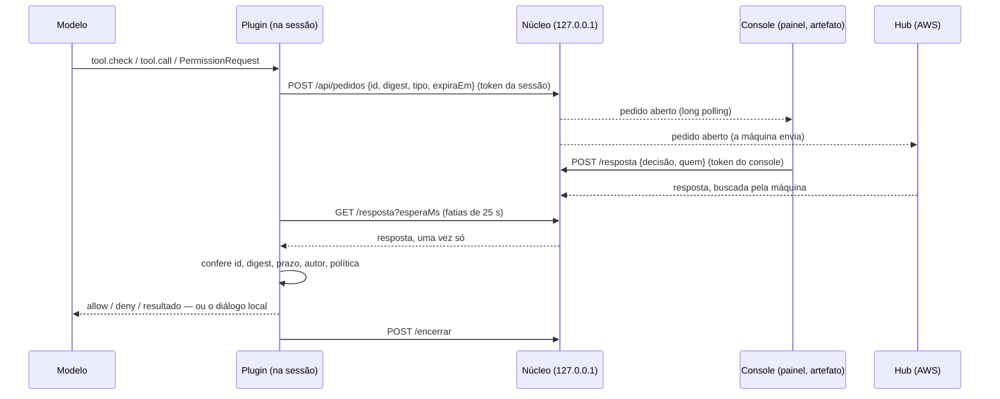

# 0003 · Como o console responde à sessão

- **Status:** aceita
- **Data:** 2026-10-18
- **Issue:** [#58](https://github.com/ahrenatechnology/ahrena-console/issues/58) (spike 9.1 do [backlog](../backlog-0.0.1.md), épico [#9](https://github.com/ahrenatechnology/ahrena-console/issues/9))
- **Destrava:** 9.2 a 9.6 ([#59](https://github.com/ahrenatechnology/ahrena-console/issues/59), [#60](https://github.com/ahrenatechnology/ahrena-console/issues/60), [#61](https://github.com/ahrenatechnology/ahrena-console/issues/61), [#62](https://github.com/ahrenatechnology/ahrena-console/issues/62), [#63](https://github.com/ahrenatechnology/ahrena-console/issues/63))
- **Prova:** [spikes/resposta-teste](../../spikes/resposta-teste/)

> Lido nos tipos do Claude Code 2.1.299 (o `claude-code.d.ts` da skill de plugins) e provado com `claude plugin test` e `node --test`. **Não** rodei uma sessão de verdade com o plugin: o `claude -p` desta máquina não tem login próprio, e não instalei nada no escopo do usuário. O que ainda precisa de uma sessão real está marcado como **a confirmar**.

## Contexto

Uma sessão do Claude Code para em três situações à espera de uma pessoa:

1. **Pergunta:** o modelo chamou `AskUserQuestion`.
2. **Plano:** o modelo chamou `ExitPlanMode` e espera a aprovação.
3. **Permissão:** uma ferramenta caiu em "perguntar" pelas regras e pelo modo da sessão.

O Épico 9 quer que o console (painel lateral, artefato ou hub do time) responda a essas três sem o terminal, e que também mande mensagens, lance sessões e edite a configuração. Cada ação nasce desligada e é liberada pelo admin e pelo dono da sessão.

O que já sabíamos:

- **V4:** nem o núcleo nem um artefato alcançam as ferramentas internas do Claude Desktop (`host:ccd_session_mgmt` é recusado). Ninguém de fora "aperta o botão" do diálogo.
- O núcleo é um processo local em `127.0.0.1` ([validações](../validacoes-0.0.1.md)); o hub da [0002](0002-hub-aws.md) nunca chama a máquina: é a máquina que envia e que busca.

Então a resposta tem de entrar **pela própria sessão**: um plugin do Claude Code que, no ponto certo, pergunta ao núcleo se o console já respondeu.

## O que a API de plugins oferece

Levantado nos tipos do engine. "Responde" quer dizer que a resposta do hook decide o desfecho.

| Ponto | O que é | Responde? | Serve para |
| --- | --- | --- | --- |
| `tool.check` | O veredito de permissão de cada chamada (`allow` / `ask` / `deny`). O hook chama `next(e)`, lê o veredito do Claude Code e pode trocá-lo | **Sim**, nos dois sentidos. Mas para ferramenta que exige a pessoa (pergunta, plano) "só aperta": um `allow` não dispensa o diálogo | **Permissão** |
| `tool.call` | A chamada de qualquer ferramenta. Um hook que devolve `{ result }` sem chamar `next` responde no lugar da ferramenta; `{ deny }` recusa com um texto que o modelo lê | **Sim** | **Pergunta** (devolve `{ questions, answers }`, o formato de saída do `AskUserQuestion`). Recusar plano |
| `classic.PermissionRequest` | O hook clássico que roda quando o diálogo de permissão vai abrir. Responde `allow` (com `updatedInput` e `updatedPermissions`, inclusive `setMode`) ou `deny` com mensagem | **Sim** | **Plano**: é o único ponto que sai do modo plano (`setMode`). Nenhum `$` muda o modo |
| `classic.Notification`, `classic.Stop`, `session.*`, `turn.*` | Avisos de que a sessão parou, terminou o turno, começou | Não decidem nada | Saber **que** há algo esperando (máquina de estados do Épico 1) |
| `prompt.submit` / `$.prompt.submit` | Muda o texto enviado; `$.prompt.submit` põe um prompt na fila, que vira turno quando a sessão fica ociosa | Injeta texto | **Mensagem** para sessão parada (9.4) |
| `$.command.run` | Roda um comando de barra como se a pessoa digitasse, quando a sessão fica ociosa | Executa | `/compact`, `/clear` (9.4) |
| `$.http.fetch` | Rede pelo host. Aceita `socketPath` (Unix socket) | — | Falar com o núcleo |
| `$.ui.ask`, `ui.render` de `AskUserQuestion` | Desenham o diálogo local | Não servem para resposta remota | — |

Três achados que pesam:

- **O tempo de um `$` não conta no orçamento do hook** (10 s por hook). Um hook pode esperar o núcleo por long polling, em fatias, sem estourar.
- **Onde a organização gerencia o Claude Code, `classic.PermissionRequest` de um plugin instalado pela pessoa não roda** (aviso do `claude plugin validate`). Só um plugin listado nas configurações gerenciadas roda esse evento. `tool.check` e `tool.call` não têm essa restrição.
- **Enquanto o hook espera, o diálogo local não abre.** Os canais são em sequência, não em corrida: primeiro a janela do console, depois o terminal.

## Decisão

**O plugin do Ahrena Console responde à sessão por hooks, sempre do mesmo jeito: publica um pedido no núcleo, espera uma janela curta pela resposta de uma pessoa e, sem resposta válida, devolve a vez ao diálogo local como se não existisse. O plugin nunca decide sozinho.**

### Por tipo

- **Permissão (9.3):** `tool.check`. Só entra quando o veredito do Claude Code já é `ask` numa chamada real (`tool_use_id`). Permitir vale **uma vez**: o plugin nunca grava regra ("sempre permitir").
- **Pergunta (9.2):** `tool.call` de `AskUserQuestion`. Com resposta, o hook devolve `{ questions, answers }` e o diálogo não abre. As respostas precisam cobrir exatamente as perguntas feitas. **A confirmar** numa sessão real que o Desktop e o terminal aceitam o resultado sem desenhar o diálogo.
- **Plano (9.2):** recusar com comentário funciona por `tool.call` (`{ deny }`) ou por `classic.PermissionRequest`. **Aprovar** só por `classic.PermissionRequest` com `setMode` `default` ou `acceptEdits`. Onde a organização gerencia o Claude Code, o plugin precisa estar nas configurações gerenciadas, ou a aprovação fica no terminal. **A confirmar** numa sessão real.

### Ligado só de propósito

- `esperaMs` é `0` por padrão: nada é consultado. O admin libera a ação no hub e o dono da sessão liga a janela (o Podium faz igual).
- A janela padrão sugerida, quando ligada, é 60 s. Passado o prazo, o pedido é encerrado no núcleo e o terminal assume.

## Modelo de ameaça

| Ameaça | Defesa |
| --- | --- |
| Outro processo ou usuário do Mac responde | Núcleo só em `127.0.0.1`; dois tokens aleatórios em arquivo `0600` (`~/.ahrena-console/`): o da **sessão** (publica e espera) e o do **console** (lista e responde). Um não faz o papel do outro. No produto, preferir Unix socket num diretório privado (`$.http.fetch` aceita `socketPath`) |
| Página web no navegador chama o núcleo (CSRF, DNS rebinding) | Recusa qualquer requisição com `Origin` e qualquer `Host` que não seja `127.0.0.1:<porta>` ou `localhost:<porta>`. O artefato fala pelo MCP da extensão, não por HTTP. Algumas exceções, só para a `/ui` que o próprio núcleo serve (veja abaixo) |
| Resposta dada para outra chamada | O plugin calcula um `digest` SHA-256 de sessão, tipo, ferramenta, id da chamada e argumentos, e só aceita resposta com o mesmo `id` de pedido e o mesmo `digest`. O núcleo copia os dois do pedido guardado: o console não os escolhe |
| Replay | Pedido com `id` aleatório e `expiraEm`. O núcleo entrega a resposta **uma vez** e encerra o pedido; o plugin guarda os ids usados. Segunda resposta: `409`; depois do prazo: `410` |
| Resposta sem pessoa | Toda resposta leva `quem` e `canal` (`painel`, `artefato`, `hub`), que vão para a auditoria e para o texto que o modelo lê ("Permitido uma vez por ana, pelo painel") |
| Hub comprometido ou conta do time invadida | O hub nunca chama a máquina: o núcleo busca as respostas no hub ([0002](0002-hub-aws.md)). Resposta remota só para quem o hub autenticou (GitHub) e que é **dono da sessão** ou foi liberado por ele; o admin liga a ação por organização. No produto, o hub assina a resposta e o núcleo confere antes de aceitar |
| Núcleo fora do ar, lento ou com bug | O plugin cai no diálogo local. Os hooks têm `.catch` que devolve o veredito do Claude Code: uma falha nunca vira `allow` |
| Escalada pelo próprio console | O console não liga `bypassPermissions`, `dontAsk` nem `auto`; não grava regras de permissão; não libera nada que a organização limitou a `ask` (o `ceiling` do `tool.check`) |

### Owner proof on local HTTP (#302, 2026-10-31)

A second macOS/Linux user is in the threat model: loopback and an exact `Origin` are not identity. Before route dispatch, every write and every private read requires `Authorization: Bearer <owner token>`. This includes hooks, MCP, conversations, events, long polls and future runtime/start/resume/send/cancel/approval/stream routes. There is no route-specific exemption for new managed execution. Only static `/ui` GETs, `/api/overview` and `/api/hooks/health` are anonymous. Host and Origin checks remain additional defenses; cross-site and same-site browser requests are refused even with a bearer.

The existing per-process `nucleo.json` token is random (256 bits), in the installation's owner-only lock (0600, directory 0700). Until the lock is claimed the gate denies requests. Restart replaces the token. Native desktop and local Claude clients read it from their owner context; it is never emitted in status, the registry, logs, an HTTP GET, an HTML response or a URL. The desktop initializes only its own top-level core `/ui` window with the credential, and rebuilds that window when it adopts a new core. UI reads and writes send the header. A browser tab opened directly at the public `/ui` has no proof and cannot access private data or write; use the native app for authenticated UI access.

The owner context expires on revocation/restart. Pending streams and long polls are closed when their context is revoked; reconnect requires the current credential. HTTP caches are disabled on authenticated responses. For explicit `--demo`/`--no-lock` development only, `AHRENA_CONSOLE_OWNER_TOKEN_FILE` names a current-user-owned, regular, non-symlink 0600 file containing exactly 64 lowercase hex characters; no file means no private access. This is an explicit filesystem bootstrap, never an authentication bypass.

A bearer proves the OS owner, not the identity or billing eligibility of a managed agent. Provider/account gates in #377/#382 remain mandatory before inference. Subscription login and token estimates are not billing proof. This change performs no inference.

Alternatives: embedding a token in public HTML fails because another local user can GET it. An HttpOnly cookie would still need owner-proven bootstrap and would not authenticate existing native clients. Unix sockets provide a strong OS boundary but require changing every browser/desktop transport. The existing protected lock plus native bootstrap gives one HTTP contract without publishing the secret. Remote SSH tunnels currently do not convey remote-owner proof; they must fail closed until a separately reviewed remote credential bootstrap exists ([#388](https://github.com/ahrenatechnology/ahrena-console/issues/388)). Never forward the local owner's token to a remote core.

### As exceções de mesma origem da `/ui`

A `/ui` ([#26](https://github.com/ahrenatechnology/ahrena-console/issues/26)) é servida pelo núcleo na mesma origem, e o navegador manda `Origin` até num `fetch` da mesma origem. Por isso o núcleo aceita `Origin` nos casos abaixo, sempre com `Host` igual a `127.0.0.1:<porta>` ou `localhost:<porta>` e `Origin` exatamente `http://<Host>`:

- **Ler:** qualquer `GET`.
- **Abrir a sessão no Claude Desktop** ([#29/#30](https://github.com/ahrenatechnology/ahrena-console/issues/29)): só `POST /abrir/<local_…>`, em JSON.
- **Mover um card do Kanban do projeto** ([#80](https://github.com/ahrenatechnology/ahrena-console/issues/80)): só `POST` em exatamente `/api/projeto/mover`, com `Content-Type: application/json` (um formulário de outra página não manda sem preflight) e corpo de até 4 KiB.
- **Mandar mensagem a uma sessão com processo vivo nesta máquina** ([#61](https://github.com/ahrenatechnology/ahrena-console/issues/61), [uso](../session-messages.md)): só `POST` em exatamente `/api/sessions/<id>/messages` (caminho cru, sem query e sem codificação), com `Content-Type: application/json`, e dois limites separados: o texto, já decodificado, de 1 byte a 16 KiB em UTF-8 (acima disso, `400 invalid_text`); e o corpo, de até 96 KiB e 64 bytes (6 × 16 KiB + 64), lido antes do `JSON.parse` e com folga para o envelope `{"text":…}` e o pior escape do JSON, para que um texto dentro dos 16 KiB nunca bata no limite do corpo (acima dele, `413`). Mais estrita que as outras: sem `Origin` também é recusada (`403`, `ui_only`), porque só vale texto escrito por uma pessoa na `/ui`, nada em lote e nada gerado. O `Origin` barra navegador, não processo local: um programa pode forjar `Origin: http://<Host>`, mas agora é recusado sem o segredo do dono pela [#302](https://github.com/ahrenatechnology/ahrena-console/issues/302). Uma mensagem por vez por sessão e um limite de rajada. A mensagem vai pela caixa de entrada entre sessões do Claude Code e chega como "de outra sessão": não aprova permissão nem roda comando. Só local: o hub nunca chama a máquina. O texto nunca vai para log, erro, auditoria nem banco; a auditoria guarda hora, sessão, mecanismo `inbox`, resultado e o SHA-256 do texto. O núcleo não abre o arquivo `.key` da sessão.

Toda outra escrita com `Origin`, mesmo o nosso, continua 403. A única página nessa origem é a `/ui`, que desenha o dado do núcleo e do GitHub só como texto (`textContent`) e tem uma política de conteúdo que bloqueia script de fora. Como `GET /api/projeto` chama o GitHub e gasta a cota do token, o núcleo também recusa esse `GET` quando o navegador diz `Sec-Fetch-Site: cross-site` ou `same-site` (um `` de outra página não manda `Origin`).

**Auditoria.** O núcleo grava uma linha por evento (pedido, resposta, encerramento) com hora, sessão, ferramenta, quem, canal e decisão. O hub recebe as mesmas linhas pela ingestão. Os argumentos ficam no pedido, para a pessoa ver o que aprova, e passam pela redação de segredos da 7.6 antes de sair da máquina.

### O que nunca é automatizado

- **Nenhuma resposta por regra.** O console só repassa a decisão de uma pessoa. Nada de "aprovar tudo de tal sessão" ou de responder perguntas com um modelo.
- **Só o terminal libera** (o console ainda pode **negar**, que é o lado seguro):
  - `rm -r…`, `git push --force`, `git reset --hard`, `git clean -f`, `sudo`, `curl … | sh`;
  - escrita em `.claude/settings*.json`, `.claude/hooks/`, `.mcp.json`, `.env*`, `~/.ssh/`, `~/.ahrena-console/`;
  - toda chamada com teto `ask` da organização.
- **Nada permanente pelo console:** nem regra de permissão, nem modo sem permissões.

## Decisão para 9.2 a 9.6

| Item | Como | Observação |
| --- | --- | --- |
| **9.2** Responder perguntas e aprovar planos ([#59](https://github.com/ahrenatechnology/ahrena-console/issues/59)) | `tool.call` de `AskUserQuestion`; `classic.PermissionRequest` de `ExitPlanMode`; API de pedidos no núcleo; o painel e o artefato listam os pedidos abertos e respondem | Primeiro passo: confirmar numa sessão real os dois **a confirmar** acima. Onde não roda o `PermissionRequest`, o console só recusa plano |
| **9.3** Permitir ou negar uma vez ([#60](https://github.com/ahrenatechnology/ahrena-console/issues/60)) | `tool.check` como na prova, com a lista "só o terminal libera" | Mostrar no console o comando ou o diff que será aprovado, não só o nome da ferramenta |
| **9.4** Mensagem, `/clear`, `/compact` ([#61](https://github.com/ahrenatechnology/ahrena-console/issues/61)) | O plugin busca ordens no núcleo por `$.clock.every` e roda `$.prompt.submit` (mensagem) ou `$.command.run` (`compact`, `clear`) quando a sessão está ociosa. Mesmo pedido com id, prazo, `quem` e entrega única | Só em sessão parada. O texto vindo do console entra como prompt da pessoa: marcar a origem (`quem`, `canal`) e nunca aceitar do hub sem a liberação do dono. **A confirmar** que `$.command.run` aceita `/clear`. **Primeira fatia (#61):** a mensagem vai pela caixa de entrada entre sessões do Claude Code, sem o mod, e chega como "de outra sessão" (veja as exceções de mesma origem); `/clear` e `/compact` continuam com o mod |
| **9.5** Lançar e retomar ([#62](https://github.com/ahrenatechnology/ahrena-console/issues/62)) | Fora de qualquer sessão, então não é hook: o **núcleo** lança o Claude Code CLI (`claude -p --output-format stream-json`, `--resume <id>`) como o próprio usuário, na pasta pedida | Sessão do Claude Desktop não se lança de fora (V4). Do hub, só por ordem que o núcleo busca, liberada pelo dono da máquina. Pastas permitidas numa lista local; nunca `--dangerously-skip-permissions` |
| **9.6** Editor de configuração ([#63](https://github.com/ahrenatechnology/ahrena-console/issues/63)) | O núcleo lê e grava os arquivos (skills, subagentes, comandos, `CLAUDE.md`, hooks, MCP) com backup e diff antes de gravar. Sem plugin | **Só local.** Hooks, MCP e `settings.json` executam código: editar pelo hub é execução remota. Na 0.0.1 o hub só lê a configuração |

## Alternativas consideradas

- **Só `classic.PermissionRequest` para tudo** (permissão, pergunta com `updatedInput.answers`, plano). Um ponto só e o formato do SDK. Perdeu porque não roda quando a organização gerencia o Claude Code; fica só para o plano, onde não há outro jeito.
- **Hooks de comando em `settings.json`** (um script `PermissionRequest` ou `PreToolUse` que chama o núcleo). Funciona sem mod, mas exige editar a configuração da pessoa, roda um processo por chamada e não responde perguntas. O plugin já existe para o painel.
- **Resposta em corrida com o diálogo** (o diálogo abre e o console pode responder ao mesmo tempo). Seria o ideal, mas a API não deixa fechar um diálogo aberto: o hook decide antes ou não decide.
- **O núcleo ou o hub acionarem a sessão diretamente.** Fechado pela V4, e o hub nunca alcança a máquina.
- **Resposta automática por política** (aprovar `npm test` sempre, responder com um modelo). Fora: é exatamente o que nunca deve ser automatizado. Regra permanente continua sendo coisa do `settings.json`, editado pela pessoa.

## Consequências

- O console responde **antes** do terminal: com a janela ligada, quem está no terminal espera até ela acabar. Por isso ela nasce desligada e é curta.
- O plugin vira peça de segurança: hooks com `.catch` que caem no veredito do Claude Code, testes de cada recusa e revisão de cada mudança na lista "só o terminal libera".
- O núcleo ganha dois tokens, a API de pedidos e a auditoria. O hub ganha a fila de respostas e a liberação por dono e admin.
- O caminho depende de uma API de plugins em early access: cada versão do Claude Code pede rodar os testes de novo e reler os tipos.

## O que a prova cobre

[spikes/resposta-teste](../../spikes/resposta-teste/), código descartável:

- `hooks/`: o plugin (`tool.check`, `tool.call` de `AskUserQuestion`, `classic.PermissionRequest` de `ExitPlanMode`) e 20 testes em `claude plugin test`: permitir e negar, sem resposta no prazo, núcleo fora do ar, resposta de outro pedido, digest errado, sem autor, veredito já decidido, desligado por padrão, comando que só o terminal libera, teto `ask`, pergunta respondida e com respostas erradas, plano aprovado, recusado e com `bypassPermissions` recusado, digest canônico, uso único e prazo.
- `nucleo/pedidos.mjs`: a API de pedidos com os dois tokens, `Host` e `Origin`, entrega única, prazo e auditoria, e 4 testes em `node --test`.
