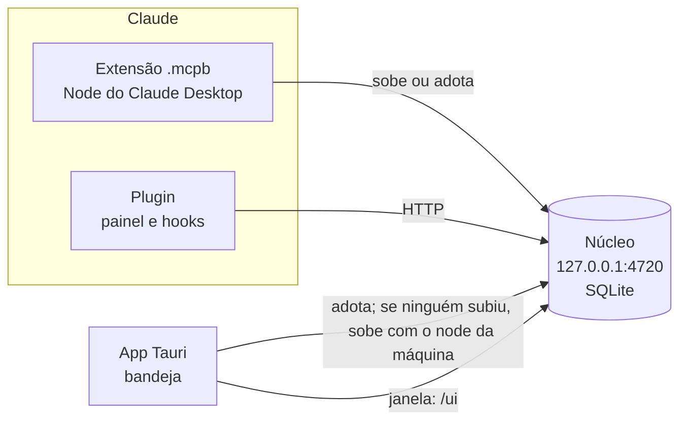

# 0005 · App desktop: uma bandeja em Tauri que complementa o Claude, sem duplicar

- **Status:** aceita
- **Data:** 2026-10-18
- **Issue:** [#82](https://github.com/ahrenatechnology/ahrena-console/issues/82) (spike 6.5 do [backlog](../backlog-0.0.1.md), épico [#7](https://github.com/ahrenatechnology/ahrena-console/issues/7))
- **Parte de:** [0004](0004-painel-da-sessao.md), que abriu o spike
- **Prova:** [spikes/app-desktop](../../spikes/app-desktop/)

> Estudado no código do Claude Code Agent Monitor (CCAM, commit `f9188db` de 2026-10-18, app desktop 2.3.0) e provado com um esqueleto Tauri 2.12 compilado nesta máquina (macOS 26.7, Apple Silicon). Os números do Electron vêm dos releases do CCAM e de benchmarks públicos, não de uma medição minha. Não instalei nada no escopo do usuário: o Rust ficou dentro do worktree. Não assinei nem notarizei: isso exige a conta paga da Apple.

## Contexto

Hoje o Ahrena Console vive dentro do Claude: o **painel** (mod do Claude Code) olha a sessão ([0004](0004-painel-da-sessao.md)), o **artefato** olha o projeto e o time, e o **MCP** responde ao próprio Claude. O núcleo ([packages/nucleo](../../packages/nucleo/)) roda local com SQLite e, na nuvem, no hub ([0002](0002-hub-aws.md)).

O dono quer avaliar um app desktop próprio, como o CCAM, o claude-devtools, o opcode e o Conductor têm, com preferência por **Tauri** pelo peso, e sem duplicar a integração com o Claude: o app tem que usar o CLI `claude`, o login, os servidores MCP, os plugins, os hooks, o núcleo local e a extensão `.mcpb` que já estão instalados.

## A referência principal: o app desktop do CCAM

`desktop/` no repositório do CCAM: Electron 43, TypeScript, cerca de 2.400 linhas em `src/` e `scripts/`, MIT.

### Como funciona

| Peça | Arquivo | O que faz |
| --- | --- | --- |
| Servidor embutido | `server-host.ts` | Faz `require()` do `server/index.js` (Express) **dentro do processo principal do Electron**, sem processo filho. Antes, **adota** um servidor que já responda `/api/health` na 4820 (por exemplo um `npm start` aberto); senão escolhe uma porta livre (4820 a 4829, depois 49152+) e espera ficar saudável por até 30 s. Ao sair, só encerra o servidor se foi ele que subiu |
| SQLite nativo | `server-host.ts`, `electron-builder.yml` | O `better-sqlite3` precisa ser recompilado para o ABI do Electron (`install-app-deps`) e sair do asar. Para isso o app **sobrescreve `Module._resolveFilename`** e redireciona o `require` |
| Bandeja | `tray.ts` | Menu reconstruído a cada clique: "Listening on :4820", sessões ativas, agentes trabalhando, eventos de hoje (lidos de `/api/stats` a cada 4 s), Open Dashboard (⌘O), Open in Browser, Restart Server, Show Logs, Open at Login, Quit |
| Fechar não sai | `main.ts` | Fechar a janela esconde; o app segue na bandeja. Instância única (`requestSingleInstanceLock`). ⌘Q pede confirmação |
| Abrir no login | `login-item.ts` | `app.setLoginItemSettings` (SMAppService no macOS 13+, chave `Run` no Windows). Aberto no login, só a bandeja aparece |
| PATH | `shell-path.ts` | Roda `$SHELL -ilc` uma vez, captura o PATH entre marcadores e soma `/opt/homebrew/bin`, `~/.local/bin`, `~/.claude/local` e outros. Sem isso, aberto pelo Finder, o servidor não acha o `claude` para a tela Run |
| Hooks | `server-host.ts` → `scripts/install-hooks.js` | Na primeira abertura, **grava os hooks em `~/.claude/settings.json`** com `node "<caminho dentro do .app>/scripts/hook-handler.js"`. O handler descobre a porta pelo arquivo `server-info` |
| Empacotamento | `electron-builder.yml` | DMG por arquitetura e NSIS por usuário no Windows, mais um `.exe` portátil. Assinatura ad hoc por padrão; Developer ID e notarização só se houver `CSC_LINK` e `APPLE_ID` no CI (`scripts/notarize.js`) |

### O que dá certo

- **Adotar em vez de duplicar.** Se o servidor já roda, o app só olha. É o comportamento certo para um núcleo com um escritor só.
- **A bandeja como superfície sempre ligada**, com o resumo que importa e um clique para o resto.
- **A correção do PATH**, simples e necessária: um app aberto pelo launchd herda `/usr/bin:/bin:/usr/sbin:/sbin`.
- **Fechar não é sair**, e o app aberto no login fica só na bandeja.

### O que não dá certo

- **Peso.** O DMG da 2.3.0 tem **143 MiB** (arm64) e o README fala em ~250 MB instalados, "a taxa padrão do Electron". O servidor e o `node_modules` inteiro do projeto vão junto.
- **Sem atualização automática.** Não há `electron-updater`. O "update scheduler" do servidor faz `git fetch` num checkout, que não existe num DMG. Quem instalou baixa o próximo DMG à mão.
- **Sem assinatura de verdade nos releases.** O guia manda rodar `xattr -cr "/Applications/Claude Code Monitor.app"`. No macOS 15 em diante o caminho sem terminal é Ajustes › Privacidade e Segurança › "Abrir Mesmo Assim", com senha de administrador. Para um time, é atrito em cada máquina.
- **Duplica a integração com o Claude.** Grava hooks em `~/.claude/settings.json` com caminho absoluto para dentro do `.app`, que quebra se o app mudar de lugar e depende de um `node` no PATH do Claude Code. É exatamente o que a [0003](0003-responder-sessao.md) e o item 6.2 resolvem pelo plugin.
- **Gambiarras de módulo nativo** (ABI do Electron, asar, `_resolveFilename`) para ter SQLite. O núcleo do Ahrena usa `node:sqlite` embutido e não precisa disso.
- **Banco compartilhado sem dono.** O app e o `npm start` usam o mesmo `~/.claude/agent-dashboard/`, mas se a adoção falhar (porta diferente) dois servidores escrevem no mesmo SQLite.

## As outras referências

| | Plataforma | Como fala com o Claude Code | O que reaproveita | Instala e atualiza |
| --- | --- | --- | --- | --- |
| **CCAM** | Electron 43, servidor embutido | Hooks gravados em `settings.json`; lança `claude` (tela Run); lê `~/.claude/projects` | CLI pelo PATH do shell | DMG e NSIS, ad hoc, sem updater |
| **claude-devtools** | Electron | Só lê os JSONL (local ou por SSH) | Nada além dos arquivos | Homebrew, DMG, Docker |
| **opcode** | Tauri 2 | Acha o `claude` (caminho salvo, `which`, nvm, lista fixa, a versão mais alta) e roda com `std::process::Command`; importa a configuração MCP do Claude Desktop | CLI, login e MCP do usuário | Sem sidecar; o updater está no `Cargo.toml` mas não é registrado; último release ago/2025, `.app.tar.gz` de 12,6 MB |
| **Conductor** | Nativo (macOS), fechado | Roda os CLIs em worktrees | Assinatura do usuário | App assinado, pago |
| **Nimbalyst** | Electron + iOS | Roda os agentes; cliente MCP próprio | Pouco: é uma IDE paralela | Electron |
| **parallel-code** | Electron + web no celular | Roda os CLIs em worktrees | CLI do usuário | Electron, sem Windows |

O padrão é o mesmo: os que **reaproveitam** acham o CLI já instalado e leem `~/.claude`. Os que **duplicam** gravam a própria configuração de hooks, rodam o próprio cliente MCP ou viram uma IDE que compete com o Claude Desktop. Nenhum deles roda dentro do Claude; o Ahrena Console já roda.

## O que o app daria que o painel, o artefato e o MCP não dão

| | Painel (mod) | Artefato | MCP | **App** |
| --- | --- | --- | --- | --- |
| Visível com o Claude fechado ou minimizado | Não | Não | Não | **Sim, na barra de menus** |
| Notificação do sistema quando uma sessão precisa de você | Não | Não | Não | **Sim** |
| Abrir no login e manter o núcleo vivo | Não | Não | O Claude Desktop sobe a extensão só com ele aberto | **Sim** |
| Janela própria, fora da aba Code, ⌘Tab, segundo monitor | Não | Aba do Claude | Não | **Sim** |
| Sessões do terminal e headless sem o Claude Desktop aberto | Só dentro de uma sessão | Precisa do Desktop | Precisa de um cliente | **Sim** |
| Contexto da sessão (sabe qual é "esta") | **Sim** | Não | Pelo Claude | Não |
| Publicar e compartilhar com o time | Não | **Sim** | Não | Não |
| Responder à sessão (0003) | Pelo plugin | Pelo núcleo | Pelo núcleo | Pelo núcleo, igual |

O ganho real é **atenção fora do Claude**: a bandeja e a notificação de "precisa de você", e um núcleo que roda desde o login. Isso fecha um buraco do próprio produto: hoje a extensão `.mcpb` só existe enquanto o Claude Desktop está aberto, e o painel só enquanto uma sessão está aberta. O artefato continua sendo o lugar do projeto e do time.

**Complementa, não substitui o artefato.** A janela do app abre a mesma interface que o núcleo serve (a do artefato, servida por HTTP local), sem uma terceira cópia de telas. O que é só do app é pequeno: bandeja, notificação, abrir no login, ciclo de vida do núcleo.

### O que custaria manter

- **Assinatura e notarização:** conta Apple Developer (US$ 99/ano), certificado Developer ID no CI e notarização a cada release. Sem isso, cada pessoa do time passa pelo "Abrir Mesmo Assim". No Windows, um certificado de assinatura de código à parte, ou o aviso do SmartScreen.
- **Atualização:** chave própria do updater, guardada como segredo; perder a chave impede atualizar quem já instalou.
- **CI de três sistemas**, com Rust: o build do Tauri leva minutos, contra segundos do Electron.
- **Mais um pacote para versionar** junto com o `.mcpb` e o plugin (6.3), e a compatibilidade entre eles (7.11).
- **Duas WebViews diferentes** se houver Windows: WKWebView no Mac, WebView2 no Windows (e WebKitGTK no Linux).

## Tauri ou Electron

**Confirmado: Tauri**, com uma condição: **não embutir um Node**. O núcleo continua sendo o mesmo processo Node que já existe; o app só o adota ou o sobe.

| | Electron (CCAM) | Tauri (prova) |
| --- | --- | --- |
| DMG | 143 MiB (CCAM 2.3.0, arm64) | **1,5 MiB** |
| `.app` instalado | ~250 MB (README do CCAM) | **3,4 MiB** |
| Memória ociosa (bandeja, sem janela) | Não medida aqui; benchmarks públicos dão ~360 MB para um app Electron vazio | **31 MB** de footprint (43 a 63 MB de RSS), 0% de CPU |
| Build do zero | segundos (só `tsc` + `electron-builder`) | **167 s** (95 s ao mudar uma linha, por causa do LTO) |
| Motor da janela | Chromium próprio, igual em todo sistema | WebView do sistema |
| Núcleo em Node | No mesmo processo (`require`) | Processo à parte (sidecar ou adotado) |
| Bandeja, notificação, login, instância única | Nativos do Electron | Plugins oficiais (`tray-icon`, `notification`, `autostart`, `single-instance`) |
| Atualização automática | `electron-updater` (o CCAM não usa) | `tauri-plugin-updater`, assinatura obrigatória, `latest.json` em GitHub Releases (o `tauri-action` gera) |
| Assinatura e notarização | `electron-builder` + `@electron/notarize` | O bundler assina o app e os sidecars; mesmas variáveis `APPLE_*` |

O Electron só ganharia se o núcleo precisasse rodar dentro do app. Não precisa: o núcleo já é um processo Node separado em `127.0.0.1`, que o Claude Desktop sobe pela extensão e o plugin consulta.

### Como o app fala com o núcleo

**Um núcleo por máquina; quem chegar primeiro serve, os outros adotam.**

1. **Adotar.** O app consulta o núcleo em `127.0.0.1:4720`. Se responde, só olha e nunca o encerra (como o CCAM).
2. **Subir, se ninguém subiu.** Roda `node <núcleo>` como processo filho, com o `node` achado pelo PATH do shell de login. Como o núcleo é TypeScript rodado direto pelo Node 24 e sem dependências, basta empacotar a pasta do núcleo como recurso do app (alguns MB).
3. **Sem Node na máquina:** o app avisa e o núcleo fica com a extensão `.mcpb` (que roda no Node do próprio Claude Desktop). Empacotar um Node dentro do app custaria de 57 MB (`bun --compile`) a 93 MB (Node SEA) e apagaria a vantagem do Tauri; fica como último recurso, não como padrão.
4. **Um escritor só.** O núcleo de produto ganha um arquivo de trava com pid e porta (`~/.ahrena-console/nucleo.json`), para a extensão, o app e um terminal não subirem dois. O handler de hooks e o painel leem a porta dali, como o `server-info` do CCAM.
5. **Ao sair,** o app encerra só o núcleo que ele subiu (SIGTERM, depois SIGKILL). O núcleo também sai sozinho se o processo pai sumir, para não ficar órfão se o app cair.

### Como o app reaproveita o que já está instalado

| Já instalado | Como o app usa | O que o app **não** faz |
| --- | --- | --- |
| CLI `claude` e o login | Acha pelo PATH do shell de login (e `~/.local/bin`, como o opcode). Quem lança sessão (9.5) é o núcleo, com o CLI e o login do usuário | Não guarda credencial, não chama a API da Anthropic, não usa o Agent SDK com chave própria |
| Hooks | São do plugin (1.4, 6.2) e escrevem no núcleo. O app vê o resultado | Não grava hooks em `settings.json` (o erro do CCAM) |
| Plugins e painel | Lê `~/.claude/settings.json` para dizer se o plugin está habilitado e sugerir instalar | Não instala nem edita plugins |
| Servidores MCP | Nenhum uso direto: quem fala MCP é o Claude, com o núcleo | Não é cliente MCP, não importa configuração |
| Extensão `.mcpb` | Detecta se está instalada; quando o Claude Desktop está aberto, quase sempre é ela que já subiu o núcleo | Não substitui a extensão: o artefato precisa dela para o `host:` |
| Núcleo local | Adota ou sobe, e mostra o estado | Não tem banco nem lógica própria |

## Decisão

**O Ahrena Console ganha um app desktop pequeno, em Tauri 2, que complementa o painel e o artefato. Ele é uma bandeja: mostra quem precisa de você, notifica pelo sistema, abre no login, garante que o núcleo esteja de pé e abre a interface do núcleo numa janela própria. Não tem telas próprias, não grava configuração do Claude e não embute Node.**

Fica **fora da 0.0.1** (M1 · Local), que entrega o núcleo, o plugin e a extensão. O app entra depois do 2.1 (quem precisa de mim) e do 2.4 (long polling), que são a fonte da bandeja e das notificações, e antes do hub, porque a notificação local não depende da nuvem.

## Medições da prova

[spikes/app-desktop](../../spikes/app-desktop/): Tauri 2.12, perfil release com `opt-level = "s"`, LTO e `strip`; plugins `tray-icon`, `notification`, `autostart` e `single-instance`; ícone gerado de `docs/brand/logo-laranja.svg`.

| | Medido | Como |
| --- | --- | --- |
| `.app` | **3,4 MiB** | saída do `tauri build` |
| DMG | **1,5 MiB** | idem |
| Build do zero | **167 s** | `tauri build` com dependências já baixadas, Apple Silicon |
| Build depois de mudar uma linha | **95 s** | `cargo build --release`; quase tudo é o LTO. Em desenvolvimento, sem LTO, é bem menos |
| Memória do app, só bandeja | **31 MB** de footprint, 43 a 63 MB de RSS | `footprint` e `ps`, 3 min depois de abrir |
| CPU do app, ocioso | **0%** (0,06 s de CPU por minuto) | `ps` e `top` |
| Núcleo de teste subido pelo app | ~100 MB de RSS, ~25% de CPU | é o `nucleo-teste`, que relê 1.669 transcripts a cada `/api/fleet`; o custo é dele, não do app, e é o que a 4.6 corrige |

A memória com a janela aberta não foi medida: ela soma os processos do WebKit (WebContent, GPU, Networking), que rodam fora do processo do app.

O que a prova confirma:

- **PATH:** nesta máquina o `claude` fica em `~/.local/bin`, fora do PATH de um processo aberto pelo launchd. Rodado com o PATH mínimo (`env -i PATH=/usr/bin:/bin:/usr/sbin:/sbin … --diagnostico`), o app recupera o PATH do shell de login e acha o CLI (`claude 2.1.302`).
- **Sidecar:** aberto pelo Finder com o núcleo parado, o app subiu o núcleo de teste como filho (o `node` achado pelo PATH corrigido) e passou a mostrar as sessões na barra de menus. A adoção usa a mesma consulta de saúde, que o `--diagnostico` exercitou com o núcleo rodando; não rodei duas instâncias, porque o plugin `single-instance` só foca a primeira.
- **Integração só leitura:** o `--diagnostico` (que imprime o mesmo texto do menu) achou a versão do CLI, os plugins do console habilitados em `~/.claude/settings.json` e a extensão `.mcpb` instalada no Claude Desktop, sem escrever nada.
- **O caminho do núcleo está fixo no binário** (a pasta do spike). No produto, o núcleo vai como recurso do app.

O que a prova **não** cobre:

- Assinatura com Developer ID, notarização e o updater (dependem da conta Apple e de uma chave guardada no CI).
- Windows e Linux.
- "Precisa de você" de verdade: a prova notifica quando o número de sessões ativas cai, porque o núcleo de teste não tem a máquina de estados (1.5) nem o 2.1.
- O "Abrir no login" do plugin `autostart` grava um LaunchAgent em `~/Library/LaunchAgents`; não liguei na prova, para não mexer no escopo do usuário.

## O que entra no backlog

No épico [#7](https://github.com/ahrenatechnology/ahrena-console/issues/7) · Distribuição, depois da 0.0.1:

| # | Tipo | Item | Depende de |
| --- | --- | --- | --- |
| 6.6 | Tech task | Núcleo com dono único: arquivo de trava com pid e porta, adoção pela extensão, pelo app e pelo terminal, saída quando o pai some | 1.1 |
| 6.7 | User story, frontend | App desktop (Tauri) na bandeja: "N precisam de você" na barra de menus, menu com as sessões esperando e clique que abre a sessão; janela que abre a interface do núcleo | 2.1, 2.4, 6.6 |
| 6.8 | User story, frontend | Notificações do sistema quando uma sessão passa a esperar, com o motivo (pergunta, plano, permissão), ligadas por padrão e com silêncio por sessão | 6.7, 1.5 |
| 6.9 | Tech task | Abrir no login com SMAppService, começando só na bandeja. O plugin `autostart` 2.7 só oferece LaunchAgent (um plist em `~/Library/LaunchAgents`) e AppleScript, embora a crate `auto-launch` 0.6 por baixo já suporte SMAppService | 6.7 |
| 6.10 | Tech task | Release assinado e notarizado (Developer ID), updater com `latest.json` no GitHub Releases, build no CI com `tauri-action` | 6.7, 6.3 |

Ficam de fora, de propósito: telas próprias no app, cliente MCP, instalação de hooks, terminal embutido, Node embutido e Windows/Linux antes de o Mac estar estável.

## Alternativas consideradas

- **Electron com servidor embutido, como o CCAM.** Ganharia rodar o núcleo no mesmo processo e um motor de página igual em todo sistema. Perdeu pelo peso (143 MiB de DMG para uma bandeja, contra 1,5 MiB) e porque o núcleo já é um processo à parte.
- **Tauri com Node embutido como sidecar** (`bun --compile`, Node SEA ou `pkg`). Funciona e é o guia oficial do Tauri, mas soma de 57 a 93 MB e um segundo Node para manter atualizado. Fica como plano B para máquinas sem Node.
- **Sem app: só o painel, o artefato e o MCP.** Mais barato, mas ninguém avisa quando o Claude está minimizado, e o núcleo some quando o Claude Desktop fecha. É o caso de hoje e continua valendo na 0.0.1.
- **App nativo em Swift** (como o Conductor). Menor e mais integrado ao macOS, mas só Mac, uma segunda linguagem de UI e nenhum reaproveitamento da interface web do núcleo.
- **App que vira um console completo** (telas próprias, lançar e retomar sessões, editar configuração). Duplicaria o artefato e competiria com o Claude Desktop, que é a fraqueza apontada no opcode e no Nimbalyst.

## Consequências

- Três pacotes para distribuir (extensão, plugin, app) e uma matriz de compatibilidade entre eles. O app é opcional: sem ele, tudo da 0.0.1 continua funcionando.
- O núcleo precisa de dono único antes do app (6.6), o que também protege a 0.0.1 contra a extensão e um terminal subirem dois núcleos.
- Assinatura e notarização passam a ser pré-requisito de distribuição, com custo anual e segredos no CI.
- A interface do núcleo servida por HTTP local vira uma superfície a mais: valem as defesas da [0003](0003-responder-sessao.md) contra `Origin` e `Host` estranhos.
