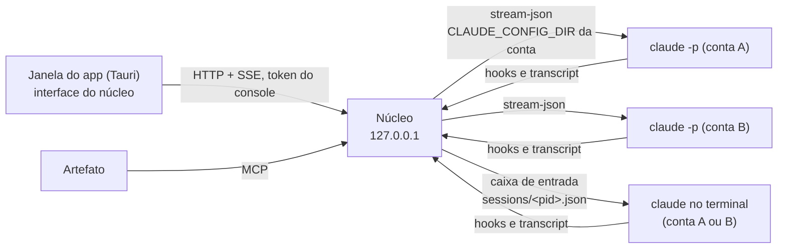

# 0007 · Chat e delegação de prompts pelo console, com várias contas

- **Status:** proposta
- **Data:** 2026-10-19
- **Issue:** [#120](https://github.com/ahrenatechnology/ahrena-console/issues/120) (spike 9.7 do [backlog](../backlog-0.0.1.md), épico [#9](https://github.com/ahrenatechnology/ahrena-console/issues/9))
- **Mexe em:** [0003](0003-responder-sessao.md) (o 9.5 lança sessões em `stream-json`), [0005](0005-app-desktop.md) (a janela do app ganha o chat, servido pelo núcleo), [0006](0006-multiplas-contas.md) (a conta escolhe a pasta de configuração)
- **Destrava:** 9.5 ([#62](https://github.com/ahrenatechnology/ahrena-console/issues/62))
- **Prova:** [spikes/chat-delegacao](../../spikes/chat-delegacao/)

> Medido com o Claude Code CLI 2.1.302 e o Claude Agent SDK (TypeScript) 0.3.302, no macOS 26.7. As sessões são **reais** (o CLI instalado), mas o modelo é uma API falsa em `127.0.0.1` que responde com eco: pastas de configuração temporárias, `HOME` falso, chave falsa. Não fiz login, não li nem escrevi a configuração real de ninguém e não gastei plano. O que só se mede com login de assinatura está marcado como **a confirmar**.

## A Anthropic já pensou nisso?

Em partes, e cada parte vê **uma conta**. O caminho oficial para embutir o Claude Code num app é o **Agent SDK**, que conversa com o CLI pelo protocolo `stream-json`: chat em streaming, retomada pelo id, permissões e interrupção. Para conversar com sessões locais de fora do terminal, a Anthropic tem o **Remote Control**, mas o cliente é só dela (claude.ai/code, o app do celular e o Claude Desktop), sem interface para um cliente próprio. Para despachar e acompanhar várias sessões, tem a **agent view** (`claude agents`), no terminal; e para uma sessão mandar prompt a outra, a **mensageria entre sessões**. Nenhuma junta várias contas numa caixa só, e a política de uso diz que um produto de terceiros não oferece o login do claude.ai. O console fica com o que falta: uma janela, todas as contas, e o `claude` da própria pessoa, sem tocar em credencial.

## Contexto

Com o terminal como modo padrão ([0006](0006-multiplas-contas.md): uma pasta de configuração por conta, `claude remote-control` em cada uma), o dono quer:

- **conversar por chat dentro do console**, principalmente na janela do app de bandeja ([0005](0005-app-desktop.md)), com qualquer sessão de qualquer conta, sem escrever no terminal;
- **delegar prompts**: mandar a uma sessão existente ou abrir uma sessão nova numa pasta e numa conta escolhidas.

A [0003](0003-responder-sessao.md) já decidiu como o console responde a pergunta, plano e permissão de uma sessão viva (pelo plugin) e deixou o 9.5 (lançar e retomar) com o núcleo rodando `claude -p`. Este registro fecha como é o chat.

## Os mecanismos

### Agent SDK e `stream-json`: o caminho oficial

O SDK roda o CLI como processo filho e fala com ele por linhas JSON em stdin e stdout ([Agent SDK overview](https://code.claude.com/docs/en/agent-sdk/overview), [TypeScript](https://code.claude.com/docs/en/agent-sdk/typescript)). O mesmo protocolo está no CLI: `claude -p --input-format stream-json --output-format stream-json --verbose` ([Headless](https://code.claude.com/docs/en/headless), [CLI reference](https://code.claude.com/docs/en/cli-reference)).

| Precisa | SDK | CLI 2.1.302 | Medido |
| --- | --- | --- | --- |
| Chat em streaming, vários turnos num processo | `query({ prompt: AsyncIterable<SDKUserMessage> })`, "o modo preferido" ([Streaming input](https://code.claude.com/docs/en/agent-sdk/streaming-vs-single-mode)) | Uma linha `{"type":"user",…}` por mensagem | Sim, nos dois |
| Retomar pelo id | `resume`, `forkSession`, `resumeSessionAt`, `sessionId` ([Sessions](https://code.claude.com/docs/en/agent-sdk/sessions)) | `--resume <id>`, `--fork-session`, `--session-id <uuid>`; `--continue` pega a mais recente da pasta | Sim: o histórico volta, o id é o mesmo; o fork ganha id novo |
| Pasta e conta | `cwd`; `env` **substitui** o ambiente do filho, então `CLAUDE_CONFIG_DIR` vai nele | `cwd` do processo e `CLAUDE_CONFIG_DIR` no ambiente | Sim: duas contas ao mesmo tempo, cada uma só na sua pasta |
| Permissão | `canUseTool`, chamado só quando a regra cai em "perguntar" ([Permissions](https://code.claude.com/docs/en/agent-sdk/permissions)) | `--permission-prompt-tool stdio`: o CLI manda um `control_request` `can_use_tool` e espera o `control_response` | Sim: negar e permitir uma vez, nos dois |
| Interromper | `interrupt()`, que devolve `still_queued` | `control_request` `interrupt` | Sim: o turno termina com `error_during_execution` |
| Mensagem no meio do turno | `priority`: `next` (padrão: Claude lê no mesmo turno, quando as ferramentas em curso terminam), `later` (vira turno novo), `now` (interrompe ou passa o trabalho para o fundo) | Mesmo campo na linha | Sem ferramenta rodando, `next` e `later` viraram turnos seguintes, na ordem |
| Listar e ler sessões | `listSessions`, `getSessionMessages` | — | Sim, com `CLAUDE_CONFIG_DIR` da conta no próprio processo |

**Autenticação, o que muda tudo para várias contas.** Tecnicamente, o CLI (e o SDK, que roda o CLI) usa o login que estiver na pasta de configuração, inclusive o de assinatura feito com `claude auth login`. A ordem é: provedor de nuvem, `ANTHROPIC_AUTH_TOKEN`, `ANTHROPIC_API_KEY`, `apiKeyHelper`, `CLAUDE_CODE_OAUTH_TOKEN` e, por último, o login de assinatura ([Authentication](https://code.claude.com/docs/en/authentication)). A política é outra conversa:

- A documentação do SDK diz que, sem aprovação prévia, a Anthropic não deixa terceiros "oferecer o login do claude.ai" nos seus produtos, "inclusive agentes feitos com o Agent SDK", e manda usar API key ([overview](https://code.claude.com/docs/en/agent-sdk/overview), [quickstart](https://code.claude.com/docs/en/agent-sdk/quickstart)).
- A página legal proíbe coletar, guardar ou intermediar credenciais do claude.ai, e permite explicitamente a pessoa entrar no **binário do Claude Code sem modificação** com a própria assinatura ([Legal and compliance](https://code.claude.com/docs/en/legal-and-compliance)).
- O SDK em si não é open source: a licença são os Commercial Terms da Anthropic.

Daí a forma da decisão: o console **não usa o SDK como dependência**. O núcleo roda o `claude` instalado da pessoa, sem modificação, em `stream-json`, na pasta onde **ela** fez `claude auth login`. O console não lê, não guarda e não repassa credencial; tira do ambiente do filho qualquer `ANTHROPIC_API_KEY`, `ANTHROPIC_AUTH_TOKEN` e `CLAUDE_CODE_OAUTH_TOKEN`, para não misturar contas (0006). Os tipos do SDK servem de referência do protocolo. Mesmo assim, conduzir a assinatura por `-p` a partir de um console de terceiros é uma leitura da política que **a confirmar** com a Anthropic (risco abaixo).

### Remote Control

`claude remote-control` liga sessões locais ao claude.ai/code, ao app do celular e ao Claude Desktop, só por conexões de saída ([Remote Control](https://code.claude.com/docs/en/remote-control)). Exige assinatura (API key não serve), e em Team e Enterprise um Owner liga a opção.

**Não há interface para um cliente próprio.** A documentação só cita os clientes da Anthropic. O SDK 0.3.302 traz um módulo `@anthropic-ai/claude-agent-sdk/bridge`, marcado `@alpha` e sem documentação, mas ele é o lado do **trabalhador** (a sessão se apresenta ao claude.ai e recebe as mensagens digitadas lá) e precisa de um token do claude.ai: usá-lo seria o console intermediar credencial. Fica fora.

O Remote Control continua como está na 0006: é o jeito de acompanhar uma conta pelo celular. Ele não é o canal do console.

### Sessões em background e agent view

`claude --bg` sobe a sessão sob um supervisor e devolve um id; `claude agents` (research preview) é a tela oficial para despachar e acompanhar várias; `attach`, `logs`, `stop`, `respawn` e `rm` cuidam delas ([Agent view](https://code.claude.com/docs/en/agent-view)). Medido numa pasta temporária:

- `claude agents --json` lista as sessões vivas da pasta de configuração, inclusive as `-p` (como `interactive`), com `status` `busy` ou `idle`.
- `claude logs` devolve a **tela** do terminal, com códigos ANSI, não mensagens. Não serve para chat.
- `claude -p --resume <id>` de uma sessão em background é **recusado** enquanto ela roda, e a mensagem sugere `--fork-session`. É a única trava de escritor único que o CLI tem.
- `--bg` não combina com `-p`, e a documentação não traz API nem socket público do supervisor.

Serve para a pessoa no terminal; para o console, só a lista em JSON.

### `claude --resume <id> -p "…"`

É o 9.5 da 0003: um processo por mensagem, sem chat ao vivo e sem permissão no meio (com `-p`, desde a 2.1.302, o que pede aprovação é negado se ninguém responder). O `stream-json` faz o mesmo e mais.

### Mensageria entre sessões: a sessão aberta noutro terminal

Toda sessão interativa ou `-p` (não a `--bare`) abre uma caixa de entrada num Unix socket; a documentação descreve o socket, a linha de `auth` e a política `crossSessionInbound` ([Cross-session messaging](https://code.claude.com/docs/en/cross-session-messaging)). Medido:

- A sessão viva se anuncia em `$CLAUDE_CONFIG_DIR/sessions/<pid>.json`, com `sessionId`, `cwd`, `status`, `kind` e `messagingSocketPath`, e o token num `<pid>.<hash>.key` ao lado (só o dono do Mac lê).
- Uma linha de usuário em `stream-json` no socket (o formato do exemplo embutido no CLI) virou um turno novo na sessão ociosa. Ocupada, a documentação diz que ela lê entre uma ferramenta e outra, sem interromper.
- A mensagem chega **marcada como vinda de outra sessão**, não da pessoa: não aprova nada, não muda configuração, e `/compact` chega como texto.
- O formato da mensagem não está documentado como interface estável; o socket e a política estão.

### Hooks e o plugin (0003)

`$.prompt.submit` do plugin põe um prompt na fila da sessão quando ela fica ociosa (9.4). Funciona só onde o plugin está instalado e não dá chat ao vivo. Fica como reserva da caixa de entrada.

### Channels

Um servidor MCP que empurra eventos para dentro de uma sessão e pode responder ([Channels reference](https://code.claude.com/docs/en/channels-reference)). Está em research preview, canal próprio exige `--dangerously-load-development-channels` e o flag é ignorado em `-p`. Fica de fora.

## Decisão

**O núcleo é o host das sessões de chat: para cada sessão que o console conversa, ele roda o `claude` instalado em `stream-json`, na pasta de configuração da conta e na pasta do projeto, e é o único escritor dela. A janela de chat do app de bandeja (a interface do núcleo) fala com o núcleo. A sessão que já está aberta noutro terminal não é assumida: recebe o prompt pela caixa de entrada da mensageria entre sessões, marcado como vindo do console.**

### 1. Mecanismo (pergunta 1)

| Sessão | Como o console entrega | Como o resultado volta |
| --- | --- | --- |
| **Do núcleo** (aberta pelo chat ou pela caixa "delegar") | `stream-json` no processo que o núcleo roda: `claude -p --input-format stream-json --output-format stream-json --verbose --permission-prompt-tool stdio`, com `--resume <id>` ou `--session-id <uuid>` | Ao vivo, pelo stdout do processo, que o núcleo repassa por SSE |
| **Aberta noutro processo** (terminal, editor, `remote-control`, background) | Caixa de entrada da sessão; sem ela, a fila do plugin (9.4) | Pelos hooks e pelo seguidor do transcript, como qualquer sessão (épico 1) |
| **Parada** (nenhum processo vivo) | O núcleo retoma (`--resume <id>`) e ela passa a ser do núcleo | Ao vivo |

O núcleo implementa o protocolo direto, sem o SDK: são linhas JSON, e o núcleo continua sem dependências. A versão do CLI entra no `doctor`, e os testes de contrato rodam a prova a cada versão.

### 2. Sessão ocupada ou aberta em outro terminal (pergunta 2)

- **Um escritor por sessão.** Dois processos retomando o mesmo id gravam no mesmo arquivo, como ramos irmãos; a retomada seguinte segue só o mais novo e o outro turno some do contexto, sem erro (cenário 6 da prova). Por isso o núcleo só retoma uma sessão quando nenhum processo a anuncia em `sessions/<pid>.json` (com o pid vivo) e guarda a própria trava por sessão. Nunca dois processos do núcleo na mesma sessão.
- **Sessão do núcleo ocupada:** a mensagem vai com `priority: next`, o mesmo que digitar no terminal enquanto ele trabalha: Claude lê entre uma ferramenta e outra. A janela mostra "na fila" até a resposta e oferece **Parar** (`interrupt`) e **Depois** (`later`, turno novo). Não há recusa.
- **Sessão aberta noutro terminal:** o console **não assume** (seria o segundo escritor). Entrega pela caixa de entrada, que espera a ferramenta em curso terminar. Na janela, essa sessão aparece como "no terminal", com o estado pelos hooks; o chat ao vivo só existe para as sessões do núcleo.
- **Trazer para o console:** depois que a pessoa fecha o terminal, o console retoma a sessão e o chat passa a ser ao vivo. Pelo caminho inverso, `claude --resume <id>` no terminal (com a mesma pasta de configuração) retoma uma sessão do núcleo depois que o console a solta: as sessões `-p` não aparecem no seletor do `/resume`, mas abrem pelo id.

### 3. Sessão nova (pergunta 3)

A caixa "delegar" pede **conta, pasta, worktree (opcional) e prompt**. O núcleo:

1. resolve a pasta de configuração da conta pelos perfis (1.15);
2. confere a pasta contra a lista de pastas permitidas;
3. gera o id (`--session-id <uuid>`), para a sessão já existir no console antes do primeiro evento;
4. roda o `claude` com `cwd` na pasta e, se pedido, `-w <nome>` (medido: com `-p`, cria o worktree em `.claude/worktrees/<nome>` e roda lá);
5. manda o prompt como a primeira mensagem e abre o chat.

O modo de permissão é o padrão da pessoa, com os pedidos indo para a janela. A sessão nova **não** entra no Remote Control nem na barra lateral do Claude Desktop. Se a pessoa quiser acompanhar uma conta pelo celular, o caminho continua sendo o `claude remote-control` daquela conta (0006).

### 4. Várias contas (pergunta 4)

A caixa é uma só. Cada sessão já tem a conta no modelo (1.12), e cada conta tem as suas pastas de configuração (`ClaudeAccount.configDirs`, 1.15). O núcleo:

- roda cada sessão com o `CLAUDE_CONFIG_DIR` da conta dela, e só com ele: medido com duas contas ao mesmo tempo, sem mistura;
- procura as sessões vivas em `sessions/` de **cada** pasta de configuração;
- recusa delegar a uma sessão "Sem conta", ou a uma conta sem pasta de configuração conhecida, e mostra o motivo;
- antes da primeira sessão de uma conta, confere se a pasta tem login (`claude auth status --json` naquela pasta devolve `loggedIn` e `authMethod`; medido numa pasta vazia, só o caso sem login) e, sem login, manda a pessoa rodar `claude auth login` ela mesma. O console nunca faz login.

### 5. Segurança (pergunta 5)

Vale tudo da [0003](0003-responder-sessao.md), mais:

| Ponto | Regra |
| --- | --- |
| Quem pode | Na máquina, quem tem o token do console (o dono do Mac, pela janela do app ou pelo artefato). A ação "delegar" nasce **ligada só no local** e desligada para o hub |
| Núcleo | Só em `127.0.0.1`, token do console, `Host` e `Origin` conferidos (0003). A janela do app é servida pelo próprio núcleo |
| Do hub | Na 0.0.1, nada. Depois (M3), só por ordem que o núcleo busca, liberada pelo dono da máquina, para uma sessão que já existe; **sessão nova pelo hub, nunca** (é rodar código numa pasta da máquina). O texto vindo do hub entra marcado com `quem` e `canal` |
| Pastas | Só pastas de uma lista local que a pessoa edita no console; nada de `~`, `/` ou fora dela |
| Modos | O console nunca liga `bypassPermissions`, `dontAsk` nem `auto`, nunca passa `--dangerously-skip-permissions` e não grava regra de permissão. Cada pedido de permissão vira um pedido da 0003, com "permitir uma vez" e a lista do que só o terminal libera |
| Credenciais | O núcleo não lê, não guarda e não repassa credencial. Tira do ambiente do filho `ANTHROPIC_API_KEY`, `ANTHROPIC_AUTH_TOKEN` e `CLAUDE_CODE_OAUTH_TOKEN` |
| Caixa de entrada | O prompt entregue a uma sessão do terminal chega como "de outra sessão": não aprova nada e não roda comando. É o lado seguro; o console não tenta disfarçar como a pessoa |
| Auditoria | Uma linha por prompt delegado: hora, quem, canal, conta, sessão, pasta, mecanismo (`stream-json` ou caixa de entrada) e o SHA-256 do texto. O texto fica na sessão, não no log |
| Nunca automatizado | Prompt gerado por regra ou por modelo, delegar em lote para várias sessões, e responder pela pessoa. O console só repassa o que uma pessoa escreveu |

### 6. Superfícies (pergunta 6)

1. **Primeiro, a janela do app de bandeja.** A 0005 diz que o app não tem telas próprias e abre a interface do núcleo numa janela; o chat é uma tela dessa interface. Lista de sessões de todas as contas (com a conta e o estado), o chat da escolhida, a caixa "delegar" e os pedidos de permissão. Um clique na bandeja numa sessão que espera abre o chat dela.
2. **Depois, o artefato,** pelo MCP da extensão: as mesmas ações como ferramentas (`delegate_prompt`, `start_session`), sem streaming, com o estado vindo do long polling (2.4).
3. **O painel não muda.** Ele vive dentro da própria sessão, que já tem a caixa de texto do Claude Code.

O estado ao vivo volta por SSE do núcleo para as sessões dele, e pela máquina de estados do épico 1 para as outras.

## O que a prova cobre

[spikes/chat-delegacao](../../spikes/chat-delegacao/), código descartável:

- `prova.mjs`: com o CLI, sessão nova com id escolhido, dois turnos, retomada pelo id num processo novo, mensagem no meio do turno, interrupção, permissão negada e permitida uma vez, dois processos na mesma sessão, fork, duas contas ao mesmo tempo e a entrega a uma sessão aberta por outro processo pela caixa de entrada.
- `sdk.mjs`: o mesmo com o Agent SDK 0.3.302 (`query` em streaming, `resume`, `canUseTool`, `interrupt`, `listSessions`).
- `chat.mjs`: o chat de terminal falso, que retoma uma sessão pelo id.

O que **não** cobre: login de assinatura de verdade (a API é falsa), Remote Control, uma sessão interativa num terminal de verdade recebendo pela caixa de entrada (a prova usou um processo `-p` como "o terminal"), `--remote-control` junto de `-p` (aceito sem erro, mas sem assinatura não dá para ver), a janela no app e a interface do núcleo.

## O que entra no backlog

No épico [#9](https://github.com/ahrenatechnology/ahrena-console/issues/9):

| # | Tipo | Item | Depende de |
| --- | --- | --- | --- |
| 9.7 | Spike | Este registro | — |
| 9.8 | Tech task | Host de sessões no núcleo: roda o `claude` em `stream-json` por conta e por pasta, retoma pelo id, um escritor por sessão (trava própria e `sessions/<pid>.json`), fila, parar e depois, permissões pelos pedidos da 0003, eventos por SSE, ambiente sem credenciais, auditoria e testes de contrato por versão do CLI | 9.7, 1.12, 1.15, 6.6 |
| 9.9 | User story, frontend | Janela de chat no app de bandeja: sessões de todas as contas, chat ao vivo com a escolhida, parar, permitir ou negar uma vez | 9.8, 6.7 |
| 9.10 | User story, frontend | Caixa "delegar": mandar um prompt a uma sessão existente ou abrir uma nova com conta, pasta da lista permitida, worktree opcional e prompt | 9.8, 9.11 |
| 9.11 | Tech task | Entrega a sessões abertas fora do núcleo pela caixa de entrada: descoberta em `sessions/` de cada pasta de configuração, estado, entrega marcada como do console, reserva pela fila do plugin (9.4) quando falhar | 1.15 |
| 9.12 | Tech task | Delegar pelo artefato e pelo MCP: ferramentas `delegate_prompt` e `start_session`, com o estado pelo long polling | 9.10, 2.4 |

O **9.5** ([#62](https://github.com/ahrenatechnology/ahrena-console/issues/62)) passa a ser feito pelo 9.8 (lançar e retomar) e pelo 9.10 (a tela), e pode fechar como duplicado quando eles entrarem.

## Alternativas consideradas

- **O Agent SDK como dependência do núcleo.** É o caminho oficial e mede igual, mas é código sob os Commercial Terms num projeto Apache-2.0, a documentação dele é a que restringe o login do claude.ai em produtos de terceiros, e ele não acrescenta nada que o protocolo não tenha. Fica como referência dos tipos.
- **Remote Control como canal do console.** Seria o ideal (já roda por conta, já tem fila e permissões), mas não tem interface para cliente próprio, e o módulo `bridge` é alfa, do lado do trabalhador e exige token do claude.ai.
- **Assumir a sessão aberta no terminal** (retomar no núcleo enquanto ela roda). Dois escritores: o transcript ramifica e um dos lados some na retomada.
- **Recusar mensagem para sessão ocupada.** Atrito sem ganho: o próprio Claude Code já sabe enfileirar.
- **`claude --bg` para as sessões do console.** Aparece na agent view e o terminal pode dar `attach`, mas não devolve mensagens estruturadas, só a tela.
- **`claude --resume <id> -p "…"`, um processo por mensagem.** Sem chat ao vivo e sem permissão no meio.
- **Channels.** Research preview, não roda em `-p`, exige flag de desenvolvimento.
- **Container por conta.** Isolaria as contas, mas a prova mostra que a pasta de configuração já separa; fica para o cliente que exige (0006).

## Consequências

- O núcleo passa a rodar processos do Claude Code: vira um supervisor, com trava por sessão, limite de sessões simultâneas e encerramento dos filhos quando sai (6.6).
- O chat ao vivo só existe para as sessões do núcleo. As do terminal recebem prompt, mas a conversa fica onde a pessoa abriu.
- As sessões do núcleo não aparecem no claude.ai/code, no celular nem na barra lateral do Desktop.
- O consumo é da conta de cada sessão, como se a pessoa digitasse. O console mostra o custo do turno (o `result` traz) por conta (1.16).
- A cada versão do CLI, rodar a prova e reler os tipos do SDK: o protocolo `stream-json` é público pelo SDK, mas a caixa de entrada e `sessions/<pid>.json` não são interface estável.

## Riscos

| Risco | Efeito | Mitigação |
| --- | --- | --- |
| A Anthropic ler o console conduzindo `-p` com a assinatura como "produto de terceiros oferecendo o login do claude.ai" | O chat por assinatura fica fora da política | O console não toca em credencial e roda o binário sem modificação, que é o uso permitido. **Confirmar com a Anthropic** antes do 9.9 sair do time; enquanto isso, o mesmo host aceita uma pasta de configuração com API key do Console |
| O uso pelo console contar como fora do "uso individual comum" dos limites do Pro e do Max | Limite cortado sem aviso | Sem automação: cada prompt vem de uma pessoa, uma sessão por vez por pedido |
| O formato da caixa de entrada ou de `sessions/<pid>.json` mudar | A entrega ao terminal para | Testes de contrato por versão; reserva pela fila do plugin (9.4); o `doctor` avisa |
| `status` de `sessions/<pid>.json` atrasado | A janela diz "ocupada" depois do fim | Usar como dica; a trava é o pid vivo, não o `status` |
| Duas sessões do núcleo na mesma pasta, editando os mesmos arquivos | Conflito de edição | Oferecer worktree na caixa "delegar" e avisar quando já há sessão viva na pasta |
| Sessão de cliente aberta na conta errada | Uso e dados no lugar errado | A caixa mostra a conta com o rótulo e a cor (1.15); a pasta permitida pode ser presa a uma conta |
