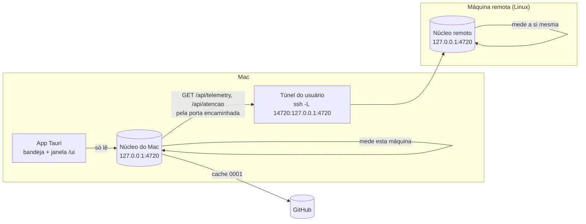

# 0008 · Telemetria das máquinas e Dev Console no app: o núcleo de cada máquina coleta, o app só mostra

- **Status:** proposta, à espera da aprovação do wireframe (C24 a C27, A6 e A7)
- **Data:** 2026-10-20
- **Issue:** a abrir no épico [#7](https://github.com/ahrenatechnology/ahrena-console/issues/7) depois da aprovação
- **Parte de:** [0005](0005-app-desktop.md) (o app é uma bandeja e a janela é a `/ui` do núcleo)

> Estudado nos dois consoles antigos, que eram artefatos do claude.ai fora deste repositório: o painel de telemetria (um coletor em Python com LaunchAgent, um servidor MCP local e a página) e o console da workstation (uma página com os números escritos à mão a cada medição), mais as páginas do Dev Console (estado gravado no banco do artefato por uma sessão de PM). Li o código e as ferramentas do servidor MCP; não chamei nenhuma ferramenta que muda estado. Nada da infraestrutura de quem mantém o projeto entra aqui: máquina, porta e repositório chegam pela configuração de quem usa.

## Contexto

O Ahrena Console antigo eram dois artefatos, e quem os usa quer os dois dentro do app desktop.

**A telemetria.** O coletor rodava no Mac, uma vez por minuto, e media o próprio Mac: CPU, memória, GPU, disco, rede, energia, os processos que mais usam CPU, as conexões `ssh` com as portas que cada uma escuta, o estado de cada porta do túnel (`up`, `idle`, `down`, `busy`), os logins na nuvem e as pastas de sessão do Claude por organização. A página lia isso por um servidor MCP do Claude Desktop e, pelo mesmo servidor, subia e derrubava o túnel, encaminhava portas, abria login e copiava sessões entre organizações. **Da máquina remota em si ela não media nada:** só sabia se o túnel estava de pé.

**O console da workstation.** Era o retrato da máquina remota: volumes, carga contra o número de vCPUs, memória, swap, VRAM, o que o Docker ocupa e quanto dá para recuperar, as stacks e a sessão dona de cada uma, as sessões do Claude que rodam lá, as portas em escuta e em que interface, as worktrees, e uma lista "o que pede atenção". Os números eram escritos à mão por uma sessão a cada medição. Tinha também faturamento e créditos de nuvem, que dependem de credenciais de uma conta específica.

**O Dev Console.** Um placar por contexto de trabalho (um conjunto de repositórios): PRs prontos para o merge, com CI rodando e com CI vermelho, sessões trabalhando, decisões esperando o dono; a fila de merge na ordem certa (o PR empilhado depois da base); o quadro das issues em seis colunas (A fazer, Delegada, Em desenvolvimento, Em revisão, Bloqueada, Feita); e o que foi mesclado nas últimas 24 h. As colunas saíam do GitHub (branch no remoto, PR aberto, issue fechada); "Delegada", "Bloqueada" e as decisões vinham de anotações que uma sessão de PM gravava no banco do artefato.

O que o app já tem: o núcleo em `127.0.0.1:4720` lê as sessões de todas as contas ([0006](0006-multiplas-contas.md)), sabe quem precisa de você (`/api/atencao`), tem o cache do GitHub ([0001](0001-github-consulta-cache.md)), as decisões das sessões e o long polling (`/api/mudancas`). A bandeja e a janela só leem o núcleo ([0005](0005-app-desktop.md)).

As perguntas: que métricas entram, de onde vem cada uma, como o app escolhe a fonte de cada máquina, e o que acontece sem conexão.

## Decisão

**Cada máquina mede a si mesma com o próprio núcleo. O núcleo do Mac lê o núcleo da máquina remota pela porta que o túnel do usuário já encaminha, e entrega as duas leituras à `/ui` e à bandeja. O Dev Console é derivado, no núcleo, do GitHub e das sessões, sem anotação manual. O app não coleta, não sobe túnel e não fala MCP: só mostra.**



### 1. As métricas e a fonte de cada uma

| Grupo | O que entra | Esta máquina | Máquina remota |
| --- | --- | --- | --- |
| CPU | uso em %, carga de 1, 5 e 15 min contra o número de núcleos | núcleo do Mac: `os.cpus()`, `os.loadavg()` | núcleo de lá, igual |
| Memória | usada, total, swap e, no Mac, a pressão | `os.totalmem()`/`freemem()`; no Mac `vm_stat` e `sysctl vm.swapusage`; no Linux `/proc/meminfo` | idem |
| GPU | uso e memória, quando legível | Mac: `ioreg`; senão ausente | Linux: `nvidia-smi` se existir; senão ausente |
| Disco | cada volume montado: usado, livre, total | `fs.statfs` sobre os pontos de montagem (`df -P` só para listar) | idem |
| Rede | interface da rota padrão, bytes por segundo de entrada e saída | Mac: `netstat -ibn`; Linux: `/proc/net/dev` | idem |
| Processos do Claude | quantos `claude` (CLI) e processos do Claude Desktop, CPU e memória somados, e os seis que mais usam CPU | `ps -axo` | idem (lá não há Claude Desktop) |
| Sessões | ativas, esperando, com erro, por conta | já é do núcleo (`/api/atencao`) | `/api/atencao` do núcleo de lá |
| Docker | containers rodando e parados, stacks do Compose, espaço em uso e recuperável | `docker` no PATH, se houver; senão o card não aparece | idem; é o card que mais pesa na remota |
| Portas em escuta | porta, interface (todas ou só loopback), processo e stack dona | Mac: `lsof -nP -iTCP -sTCP:LISTEN`; Linux: `ss -ltnp` | idem |
| Túnel e portas encaminhadas | cada processo `ssh` com `-L`/`LocalForward`, as portas e o estado de cada uma: `up` (responde do outro lado), `idle` (encaminhada, ninguém escuta lá), `busy` (outro processo segura a porta) | núcleo do Mac, pela lista de processos e pela sonda de porta do coletor antigo | não se aplica |
| Alertas | carga acima dos núcleos por 5 min, volume acima de 85%, swap crescendo, porta em todas as interfaces, túnel caído, máquina remota sem resposta | calculados no núcleo, sobre as amostras | calculados no núcleo de lá; o do Mac soma o "sem resposta" |

Tudo é leitura, sem `sudo` e sem dependência nova: módulos do Node e comandos que já vêm no sistema. Cada coletor é um adaptador por plataforma (`darwin`, `linux`) atrás de uma porta, testado com a saída gravada dos comandos, como o resto do núcleo.

**Amostras.** O núcleo mede a cada 30 s enquanto está de pé e guarda 12 h no SQLite (uma tabela de amostras, podada na escrita). Os gráficos mostram 1 h por padrão e 12 h a pedido. Uma mudança de estado (alerta que entra ou sai, máquina que cai ou volta) sai em `/api/mudancas`, para a tela e a bandeja reagirem sem recarregar.

**Rotas novas, só `GET`:**

- `GET /api/machines`: esta máquina e as remotas configuradas, cada uma com `state` (`connected`, `unreachable`, `not-configured`, `incompatible-version`), a hora da última leitura e o número de alertas.
- `GET /api/telemetry?machine=<id>&hours=1|12`: a leitura atual e as séries. `local` é esta máquina.
- `GET /api/dev-console?context=<id>`: o Dev Console (seção 4).

**Telas da `/ui`:** `/ui/telemetry` (esta máquina), `/ui/workstation` (a máquina remota; com mais de uma, `/ui/machines/<id>`) e `/ui/dev-console`.

**Nomes.** Seguem a regra do repositório para o que é novo: código, rotas, URLs, arquivos, classes CSS, chaves de JSON e nomes de métrica em inglês (`cpu.usedPct`, `memory.swapUsedBytes`, `disk.volumes[]`, `ports[].state`); o texto de tela em pt-BR.

### 2. Como o núcleo chega à máquina remota

A máquina remota roda o mesmo núcleo (Node 24, sem dependências; o Linux já é suportado pelos coletores da seção 1). Quem o sobe lá é quem usa, do jeito que preferir (um `systemd --user`, o próprio Claude Code); o README da 0.0.1 explica.

O núcleo do Mac não abre SSH, não guarda chave e não conhece o host. Ele lê uma configuração do usuário, `~/.ahrena-console/machines.json`:

```json
{ "machines": [ { "id": "workstation", "label": "Workstation", "port": 14720 } ] }
```

`port` é a porta **local** do Mac que o túnel do usuário encaminha para a `4720` de lá (`LocalForward 14720 127.0.0.1:4720`). A cada 30 s, e logo depois de uma mudança no túnel, o núcleo do Mac pede `GET http://127.0.0.1:<port>/api/telemetry` e `/api/atencao`, mandando o `Host` que o núcleo remoto espera (`127.0.0.1:4720`), porque a defesa da [0003](0003-responder-sessao.md) recusa `Host` estranho. Só `GET`: nada do Mac escreve na remota.

Sem arquivo, não há máquina remota e a barra lateral não mostra o item (regra de não apontar para nada interno por padrão). A tela "Esta máquina" diz como configurar.

### 3. Sem conexão

| Situação | Como o núcleo sabe | O que a `/ui` e a bandeja mostram |
| --- | --- | --- |
| Túnel caído | a porta local não aceita conexão | Workstation "sem conexão", com a última leitura e a hora; a bandeja põe a linha em cinza. Não há botão de subir túnel: o app só mostra |
| Túnel de pé, núcleo remoto parado | a porta aceita e fecha (o `idle` do coletor antigo) ou não responde HTTP em 3 s | "O túnel está de pé, mas o núcleo de lá não respondeu", com o comando para subi-lo |
| Versão diferente | o campo `version` de `/api/telemetry` | lê o que reconhece; avisa numa faixa |
| Núcleo do Mac parado | a bandeja já trata (A4) | nada muda |

A última leitura de cada máquina fica no SQLite do Mac, então a tela abre com ela e diz a idade. Uma máquina que cai gera um alerta, que a bandeja mostra e notifica uma vez (na passagem, como o [#88](https://github.com/ahrenatechnology/ahrena-console/issues/88)), sem som.

### 4. Dev Console

O mesmo desenho do Dev Console antigo, mas **derivado**, sem sessão de PM gravando estado:

| Peça | De onde vem |
| --- | --- |
| Contexto | `~/.ahrena-console/dev-console.json` (`{ "contexts": [{ "id", "name", "repos": ["owner/repo"] }] }`); sem arquivo, um contexto por repositório que teve sessão nos últimos 7 dias |
| PRs prontos, com CI rodando, com CI vermelho ou conflito | PRs abertos dos repositórios do contexto, pelo cache da 0001: CI do último commit, `mergeable`, rascunho e `reviewDecision` |
| Fila de merge | os prontos (CI verde, sem conflito, fora de rascunho, sem pedido de mudança), a base antes do empilhado e o mais antigo primeiro |
| Sessões trabalhando | sessões vivas cujo branch ou cwd é de um repositório do contexto |
| Depende de você | as sessões do contexto que esperam uma pergunta, um plano ou uma decisão (`/api/atencao`), e as decisões sugeridas ainda sem resposta |
| A fazer · Em desenvolvimento · Em revisão · Feita | issue aberta sem branch; branch com o número da issue no remoto; PR aberto que fecha a issue; fechada nas últimas 24 h |
| Delegada | uma sessão aberta num branch com o número da issue, ainda sem push: é o que a sessão de PM anotava à mão |
| Bloqueada | a etiqueta `blocked` ou `bloqueada` na issue, configurável |
| Mesclados nas últimas 24 h | PRs mesclados no contexto |

Leitura só, pelo token do `gh` que o núcleo já usa. Sem conexão com o GitHub, a tela mostra o cache com a hora, como o C19.

### 5. A bandeja

O menu ganha um bloco "Máquinas", entre quem precisa de você e o pé (A6 e A7): uma linha por máquina, com estado e o número que mais importa (CPU e o volume mais cheio), e os alertas abertos como itens que abrem a janela na tela da máquina. As sessões da máquina remota que precisam de você entram na lista de cima, marcadas com o rótulo da máquina; nelas o item ⌥ "Abrir no Claude Desktop" não aparece. O número da barra de menus continua sendo só sessões: alerta de máquina não soma ali, para o número não perder o sentido.

### 6. O que fica de fora, de propósito

- **Ações que mudam estado**: subir, parar ou reiniciar o túnel, encaminhar ou tirar portas, abrir login de nuvem, copiar sessões entre organizações. Continuam no servidor MCP e na skill de quem os tem. O app só mostra (0005), e cada uma dessas pede uma confirmação que não cabe numa bandeja.
- **Faturamento e créditos de nuvem**: dependem de credenciais e de uma conta específica.
- **Worktrees** (tamanho e estado de cada uma): pede um `git` por pasta e um `du` caro; fica para uma issue depois desta, com amostragem própria.
- **Push para o hub** ([0002](0002-hub-aws.md)): a telemetria fica na máquina; nada sai sem a 7.6.

## Alternativas consideradas

- **O núcleo do Mac entra na remota por SSH e roda os comandos lá**, como as medições à mão do console antigo. Não precisaria de núcleo lá. Perdeu porque o núcleo passaria a guardar ou usar credencial de SSH, a conhecer o nome do host e a manter dois conjuntos de comandos remotos, e porque as sessões do Claude que rodam lá (e quem precisa de você entre elas) só existem para quem lê os transcripts de lá, que é o núcleo de lá.
- **Ler pelo servidor MCP de telemetria que já existe.** Funciona hoje no Claude Desktop. Perdeu porque o núcleo e o app não são clientes MCP (0005), porque o servidor mede o Mac e não a remota, e porque ele é feito para uma infraestrutura específica, que não pode entrar num repositório público.
- **O app (Rust) coleta a telemetria do Mac.** Seria o caminho mais curto para a CPU e a memória do Mac. Perdeu porque a telemetria não existiria sem o app (o artefato, o painel e o MCP leem o núcleo) e porque a remota não tem app: o coletor teria de existir duas vezes.
- **A remota envia para o Mac** (push) em vez de o Mac buscar. Funcionaria atrás de NAT, mas exige o caminho de volta pelo túnel (`RemoteForward`) e um ponto de escrita no núcleo do Mac aberto para fora da própria `/ui`, que a 0003 fecha.
- **Dev Console com o estado anotado à mão**, como o antigo (uma sessão grava o placar). Guarda nuances que o GitHub não tem, mas para de valer quando a sessão para de gravar, e o núcleo já sabe o que a anotação dizia: qual sessão está em qual branch e quem espera uma decisão.

## Consequências

- O núcleo ganha coletores por plataforma (Mac e Linux) e uma tabela de amostras; o teste de cada coletor roda sobre saídas gravadas, sem chamar o sistema.
- Para ver a remota, quem usa sobe o núcleo lá e acrescenta uma porta ao túnel; isso vira uma seção do README, sem nome de host.
- O núcleo do Mac faz duas leituras HTTP por máquina remota a cada 30 s, em loopback.
- A `/ui` ganha três telas (Esta máquina, a máquina remota, que é a mesma tela com outro parâmetro, e Dev Console) e a barra lateral ganha a seção "Máquinas".
- O Dev Console soma consultas ao GitHub por repositório do contexto: entram no orçamento e no cache da 0001, com o TTL dos PRs.
