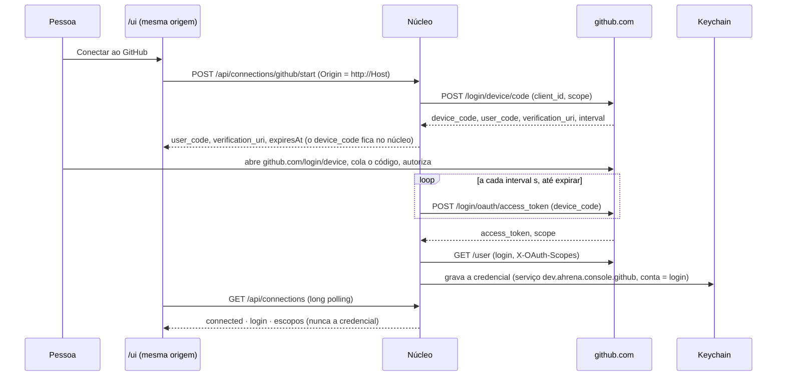

# 0011 · O console conecta ao GitHub sozinho: device flow, Keychain e a API direto

- **Status:** aceita (o Fernando aprovou a decisão e os wireframes C39 a C44 em 21/10/2026)
- **Data:** 2026-10-20
- **Issue:** [#241](https://github.com/ahrenatechnology/ahrena-console/issues/241)
- **Substitui:** em [0001](0001-github-consulta-cache.md), a credencial: "O adaptador local chama o GitHub com o token do `gh`". O cache, os TTLs, a fila única e o orçamento da 0001 continuam valendo.
- **Estende:** em [0003](0003-responder-sessao.md), a lista das escritas de mesma origem que a `/ui` pode fazer.
- **Parte de:** [0010](0010-core-per-installation.md) (um núcleo por instalação)

## Contexto

Hoje o núcleo pede o token ao `gh` (`gh auth token`, em `packages/nucleo/src/github/github-source.ts`) para ler o GitHub, e o Kanban do projeto só funciona com `AHRENA_CONSOLE_PROJECT=dono/número` no ambiente. Quem desenvolve tem as duas coisas. O app instalado (app-v0.0.1) não tem nenhuma: abre pelo Finder, sem o ambiente do terminal, numa máquina em que o `gh` pode nem existir. Repositórios, Kanban do projeto, Dev Console e Instruções ficam vazios, com uma mensagem que manda rodar `gh auth login`, coisa que a pessoa do app não deveria precisar saber.

Em 20/10 o Fernando decidiu: **o Ahrena Console autentica no GitHub sozinho, guarda o estado dessa autenticação e chama a API do GitHub direto, sem o `gh`.**

As perguntas: que tipo de aplicativo no GitHub, quais escopos, onde a credencial mora, como a `/ui` dispara o fluxo sem abrir uma porta para outra página, o que fica do `gh`, e onde o Project do Kanban é escolhido.

## Decisão

### 1. Um OAuth App público da Ahrena, com device flow

O console é um programa local e aberto: não tem onde esconder um segredo. O **device flow** do OAuth foi feito para isso: só o `client_id` vai no código, nenhum `client_secret` existe na máquina, e a pessoa confirma no próprio github.com, com a sessão e o 2FA dela.

**Como o aplicativo é criado (pelo Fernando, uma vez):**

1. Na organização `ahrenatechnology` do GitHub: *Settings → Developer settings → OAuth Apps → New OAuth App*. O dono do aplicativo é a organização, não uma pessoa, para não depender de uma conta pessoal.
2. Nome **Ahrena Console**; homepage `https://github.com/ahrenatechnology/ahrena-console`; *Authorization callback URL* o mesmo endereço (o device flow não usa callback, mas o formulário pede um).
3. Marcar **Enable Device Flow**.
4. **Não gerar client secret.** O device flow não precisa dele; um segredo gerado e esquecido é só mais uma coisa para vazar.
5. Copiar o **Client ID** (público, como `Ov23li…`) para uma issue ou para o Fernando colar no PR do núcleo. Ele entra como constante no código (`GITHUB_OAUTH_CLIENT_ID`), e `AHRENA_CONSOLE_GITHUB_CLIENT_ID` troca o aplicativo (um fork, um teste).

**Até o aplicativo existir**, o código vem com a constante vazia: sem `AHRENA_CONSOLE_GITHUB_CLIENT_ID`, a seção Conexões diz que o aplicativo do GitHub ainda não está configurado e o botão Conectar fica desligado (C44, "Aplicativo não configurado"). Nada aponta para um aplicativo de outra pessoa.

**Organizações com restrição de OAuth Apps.** Uma organização pode exigir que o dono aprove cada OAuth App. Nesse caso o GitHub esconde os dados dela até a aprovação, sem erro claro. O núcleo compara as organizações de `GET /user/orgs` com as que devolveram dados e a seção Conexões lista as que estão bloqueadas, com o link para pedir a aprovação (`github.com/settings/connections/applications/<client_id>`). A própria `ahrenatechnology`, dona do aplicativo, não precisa aprovar (a confirmar ao criar).

**Alternativas recusadas:**

| Opção | Por que não |
| --- | --- |
| **GitHub App** (com device flow e token de usuário) | Só enxerga os repositórios onde foi instalado, e cada organização da pessoa teria de instalar; Projects de usuário não ficam visíveis para GitHub App. A tela Repositórios mostra *todas* as organizações da conta. Fica como opção para o hub (7.9, na 0001), que é outra coisa. |
| **Token pessoal colado na tela** | A pessoa teria de criar o token, escolher os escopos e colar um segredo num campo; o segredo passa pela área de transferência e pela `/ui`. O device flow nunca mostra a credencial a ninguém. |
| **Continuar com o `gh`** | É o problema da issue: o app não pode exigir uma ferramenta de terminal autenticada. Fica como fonte opcional (item 5). |
| **OAuth com callback em `127.0.0.1`** | A troca do código pelo token no fluxo web do OAuth App pede o `client_secret`, que teria de morar na máquina, e o fluxo precisa de uma porta de callback aberta para o navegador. |

### 2. Escopos: `repo`, `read:org`, `project`

Os escopos de um OAuth App são grossos; estes são os menores que cobrem as telas de hoje.

| Escopo | Para quê | Por que não um menor |
| --- | --- | --- |
| `repo` | Ler repositórios privados: issues, PRs, reviews, conteúdo (instruções dos agentes, ADRs e PDRs), Actions (CI do Dev Console e das métricas), tráfego, Dependabot e code scanning (o `security_events` vem dentro do `repo`). Abrir o PR do instalador do framework (#184). | Não existe escopo só de leitura para repositório privado num OAuth App. `public_repo` deixaria de fora todo repositório privado, que é a maioria dos de trabalho. |
| `read:org` | Listar as organizações da pessoa e os repositórios de cada uma; ler os Projects das organizações; saber quais organizações bloqueiam o aplicativo. | É o escopo de leitura; nada de `admin:org`. |
| `project` | Ler os Projects (v2) e **mover um card** no Kanban do projeto (a mutação de campo). | `read:project` lê, mas não move. Se um dia mover sair, troca para `read:project`. |

**Não pedimos:** `workflow` (não editamos `.github/workflows`), `delete_repo`, `admin:*`, `user`, `gist`, `write:packages`. O `GET /user` funciona com qualquer token, sem `read:user`.

**O que o console faz com `repo`.** `repo` permite escrever, mas o núcleo só escreve em dois lugares, os dois por clique na `/ui`: mover o card do Project (`/api/project/move`, 0003) e abrir o PR do instalador (#184). Toda escrita nova no GitHub entra por esta lista, numa decisão.

**Escopo que falta.** Os escopos concedidos vêm na resposta do token e no cabeçalho `X-OAuth-Scopes` de cada chamada. Se faltar algum (a pessoa conectou com uma versão antiga do pedido), a seção Conexões mostra qual e o botão **Reconectar** refaz o device flow com a lista nova. Não há atalho tipo `gh auth refresh`: é o mesmo fluxo.

### 3. A credencial mora no Keychain, e só lá

- **macOS:** Keychain do usuário, pelo `/usr/bin/security`, como item genérico com serviço **`dev.ahrena.console.github`** e conta igual ao **login do GitHub**: uma entrada por conta. Para gravar, o núcleo abre `security -i` e escreve o comando pela entrada padrão, para a credencial **nunca aparecer na linha de comando** (o `ps` de outro processo veria). Para ler, `security find-generic-password -s dev.ahrena.console.github -a <login> -w`.
- **Linux:** Secret Service, pelo `secret-tool` (`store` lê o segredo da entrada padrão), com os atributos `service dev.ahrena.console.github` e `account <login>`.
- **Sem nenhum dos dois** (Linux sem Secret Service, um contêiner): a seção Conexões diz que esta máquina não tem onde guardar a credencial com segurança, o Conectar fica desligado e **nada é guardado**, nem em memória entre reinícios. Se o `gh` estiver autenticado, a seção oferece usá-lo (item 5).
- **Nunca** em arquivo de texto, no SQLite, no `nucleo.json` da trava, no registro de instâncias da 0010, em log, em resposta da API, em mensagem de erro, em telemetria, em fixture ou em corpo de PR.

**Uma conexão por máquina, não por instalação.** O Keychain é do usuário, não da pasta de dados: o núcleo do app, o do checkout e o da extensão (0010) leem a mesma entrada. A conta ativa (o `login`, que não é segredo) fica nas preferências da instalação; na primeira subida, se houver exatamente uma entrada no Keychain, a instalação a adota. Conectar pelo app já serve o núcleo de desenvolvimento.

**Na memória do núcleo.** A credencial é lida do Keychain na primeira chamada ao GitHub e fica numa variável do adaptador, como o token do `gh` fica hoje. O `device_code` do fluxo também só vive na memória, e some quando o fluxo termina ou expira (15 min).

**O que isto protege.** Um backup, um log ou um arquivo copiado não levam a credencial; outra página do navegador não a pede. Não protege de um programa malicioso rodando como o mesmo usuário: esse programa pode chamar o `security` do mesmo jeito, como pode com a credencial do `gh` ou do `git`. É o mesmo nível do `gh`.

### 4. Desconectar

**Desconectar** apaga a entrada do Keychain daquela conta, limpa a credencial da memória, apaga do cache do GitHub (`github_cache`) as chaves lidas com ela e devolve as telas ao "Conectar ao GitHub". O aplicativo continua autorizado no github.com até a pessoa revogar: revogar pela API exige o `client_secret`, que não existe na máquina (item 1). Por isso a confirmação de Desconectar traz o link **Revogar no GitHub** (`github.com/settings/connections/applications/<client_id>`).

### 5. O cliente da API no núcleo, e o `gh` como opção

Um cliente só (`packages/nucleo/src/github/`) faz o REST e o GraphQL com a credencial do item 3, no lugar do `ghCliToken()` que hoje entra por padrão em `createGithubWork`, `createGithubProject`, `GithubReposSource` e na fonte do Dev Console. A fila única, o cache e a pausa por limite da 0001 não mudam: só a origem do token.

A fonte da credencial fica nas preferências da instalação:

| Fonte | Quando |
| --- | --- |
| `console` (padrão) | O device flow e o Keychain deste registro. |
| `gh` | Só quem escolher, na seção Conexões ("Usar o login do `gh` desta máquina"), e só se o `gh` existir. O núcleo chama `gh auth token` como hoje. Para quem desenvolve e já tem o `gh`. |

`AHRENA_CONSOLE_GITHUB_SOURCE=gh` força a fonte `gh` para o núcleo de desenvolvimento e para os testes de ponta a ponta locais. Nunca é o padrão do app.

**Sem conexão**, cada tela que depende do GitHub (Repositórios, Kanban do projeto, Dev Console, a aba Instruções e as ADRs e PDRs) mostra o mesmo estado vazio, **Conectar ao GitHub**, que abre a seção Conexões já com o código do device flow (C42). A API responde `409` com `{ "error": "github-not-connected" }` e nenhuma chamada sai para o GitHub.

### 6. A conexão só é disparada pela própria `/ui`

As escritas novas entram na lista de mesma origem da 0003, com as mesmas condições do mover card: `Host` igual a `127.0.0.1:<porta>` ou `localhost:<porta>`, `Origin` exatamente `http://<Host>`, `Content-Type: application/json`, corpo de até 4 KiB, e recusa quando o navegador diz `Sec-Fetch-Site: cross-site` ou `same-site`.

| Rota | O que faz |
| --- | --- |
| `GET /api/connections` | O estado: `disconnected`, `pending` (com `userCode`, `verificationUri`, `expiresAt`), `connected` (com `login`, `scopes`, `missingScopes`, `blockedOrgs`), `unavailable` (sem aplicativo ou sem Keychain, com o motivo); a fonte e o cofre em uso. **Nunca** a credencial nem o `device_code`. |
| `POST /api/connections/github/start` | Começa o device flow. Um fluxo por vez: um segundo `start` devolve o mesmo código. |
| `POST /api/connections/github/cancel` | Abandona o fluxo em andamento. |
| `POST /api/connections/github/disconnect` | O item 4. |
| `POST /api/connections/github/source` | Troca entre `console` e `gh`. |
| `GET /api/project/options` | Os Projects que a conta enxerga (item 7). |
| `POST /api/project/selection` | Guarda o Project escolhido. |

**Diferente das outras escritas:** estas **exigem** o `Origin` da `/ui`. Um pedido sem `Origin` (outro processo local, o MCP, o mod, a CLI, mesmo com o token da trava) recebe `403`. Conectar é uma decisão da pessoa diante da tela; nenhum agente começa um device flow por ela.

### 7. O Project do Kanban é escolhido na tela

O Kanban do projeto deixa de depender de `AHRENA_CONSOLE_PROJECT`. Sem Project escolhido, a tela lista os Projects (v2) que a conta enxerga, os da pessoa e os das organizações dela (`viewer.projectsV2` e `organizations { projectsV2 }`, custo 1 a 2, TTL de 1 h, como a "lista de projetos e campos" da 0001), com busca, dono, número, nome, itens e se tem o campo Status. A escolha (`owner`, `number`, `field`) vai para as preferências da instalação, e o cabeçalho do Kanban ganha **Trocar de Project** (C43).

`AHRENA_CONSOLE_PROJECT` continua aceita e, quando definida, vence a preferência, com um aviso na tela. Não há Project padrão (regra 5 da `/ui`): nada aponta para o Project da Ahrena.

### 8. Preferências da instalação

O login ativo, a fonte da credencial e o Project escolhido são preferências da instalação, não segredos. Ficam numa tabela nova do SQLite, `installation_settings(key, value_json, updated_at)`, nas chaves `github.login`, `github.source` e `project.selection`. Nenhuma chave guarda credencial; um teste confere.

### 9. Testes

- **GitHub falso** (o `simulator/fake-github.ts` cresce): responde ao device flow com `authorization_pending`, `slow_down`, `expired_token` e `access_denied`, ao `GET /user` com `X-OAuth-Scopes`, e às consultas das telas.
- **Keychain falso**: o adaptador do cofre é uma porta (`get`, `set`, `delete`, `list`), com uma versão em memória. Os testes nunca chamam o `security` nem o `secret-tool` de verdade; um teste do adaptador real roda contra um `security` falso no `PATH` e confere que a credencial chegou pela entrada padrão, não pelos argumentos.
- **A credencial não vaza:** com uma credencial sentinela no Keychain falso, um teste faz o fluxo inteiro (conectar, ler cada tela, um erro do GitHub, desconectar) e procura a sentinela em todas as respostas da API, em todas as linhas de log, nos bytes do arquivo SQLite e em todos os arquivos da pasta de dados. Nenhuma ocorrência.
- **Origem:** `start`, `cancel`, `disconnect`, `source` e `selection` recusam pedido sem `Origin`, com `Origin` de outra página, com `Sec-Fetch-Site: cross-site` e sem JSON.

## Consequências

- O app instalado conecta ao GitHub sem terminal, e Repositórios, Kanban do projeto, Dev Console e Instruções funcionam.
- A Ahrena passa a ter um OAuth App público, e o nome dele aparece na tela de autorização do GitHub e na lista de aplicativos autorizados de cada pessoa. Quem fizer um fork usa o próprio, por `AHRENA_CONSOLE_GITHUB_CLIENT_ID`.
- Organizações com restrição de OAuth App precisam aprovar o Ahrena Console uma vez; até lá, os dados delas não aparecem, e a tela diz isso.
- `repo` dá escrita no código; a garantia de que o console só escreve em dois lugares é do código e desta decisão, não do escopo.
- O token de OAuth App não expira sozinho. Desconectar apaga só a cópia local; revogar é no github.com.
- Quem desenvolve e prefere o `gh` escolhe isso uma vez. Os testes e a `--demo` não mudam: usam o GitHub falso.

## Entrega

Um PR por peça, nesta ordem, depois dos wireframes aprovados:

1. **Núcleo: device flow e cofre.** A porta do cofre (Keychain, Secret Service, em memória), o device flow contra o GitHub falso, `installation_settings`, as rotas de `/api/connections` com a regra de origem, e o teste de vazamento.
2. **Núcleo: o cliente da API no lugar do `gh`.** As quatro fontes passam a pegar a credencial do cofre; `gh` vira a fonte opcional; o `409 github-not-connected`.
3. **`/ui`: a seção Conexões** em Controle (C39, C40, C41, C44) e o "Conectar ao GitHub" nas telas (C42).
4. **Kanban do projeto: a escolha do Project** (C43), com `/api/project/options` e `/api/project/selection`.
