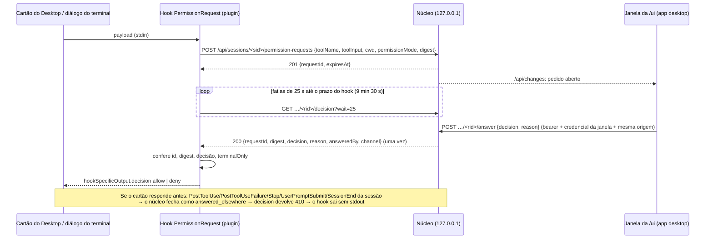

# 0025 · Pedidos de permissão respondidos pelo Console

- **Status:** aceita (plano do [#60](https://github.com/ahrenatechnology/ahrena-console/issues/60) aprovado pelo Fernando em 2026-11-14, com as respostas às perguntas Q1 a Q9 incorporadas abaixo). Um item segue **a confirmar em [#620](https://github.com/ahrenatechnology/ahrena-console/issues/620)**: a prova, no Claude Desktop real, do hook registrado pelo plugin (inclusive com chamadas paralelas).
- **Data:** 2026-11-14
- **Issue:** [#617](https://github.com/ahrenatechnology/ahrena-console/issues/617), sub-issue do [#60](https://github.com/ahrenatechnology/ahrena-console/issues/60) (9.3 do [backlog](../backlog-0.0.1.md), épico [#9](https://github.com/ahrenatechnology/ahrena-console/issues/9); complemento do épico [#376](https://github.com/ahrenatechnology/ahrena-console/issues/376))
- **Emenda:** a [0003](0003-responder-sessao.md), **só para permissão** (9.3): o "Por tipo → Permissão", a linha 9.3 de "Decisão para 9.2 a 9.6" e o "Ligado só de propósito" no que toca a permissão. Pergunta e plano ([#59](https://github.com/ahrenatechnology/ahrena-console/issues/59)) seguem a 0003. A prova do dono (#302) e a emenda da [0020](0020-remote-owner-credential-over-ssh.md) seguem valendo e são a base daqui.
- **Implementam:** [#618](https://github.com/ahrenatechnology/ahrena-console/issues/618) (núcleo), [#619](https://github.com/ahrenatechnology/ahrena-console/issues/619) (credencial da janela no app desktop), [#620](https://github.com/ahrenatechnology/ahrena-console/issues/620) (hook do plugin), [#621](https://github.com/ahrenatechnology/ahrena-console/issues/621) (`/ui`)
- **Toca:** [0009](0009-english-internals.md) (rotas, chaves, pastas e nomes em inglês; texto da tela em pt-BR)

## Contexto

A 0003 escolheu o `tool.check` do mod para permissão, com a janela do Console **antes** do diálogo local: enquanto o mod espera, o diálogo não abre, por isso a janela nascia desligada e curta. Em 2026-11-14 o Fernando pediu, num print de uma sessão parada em "Aguardando permissão" no Claude Desktop, que essas permissões possam ser aprovadas pelo próprio Console.

O spike do mesmo dia (hook de comando `PermissionRequest`, matcher `*`, primeiro no `settings.local.json`, sessões da aba Code, modo `default`) mostrou:

1. O hook dispara numa sessão da aba Code no mesmo segundo em que o Desktop emite o cartão. Payload: `session_id` (id do CLI, não o `local_…`), `transcript_path`, `cwd`, `permission_mode`, `tool_name`, `tool_input`, `permission_suggestions`. **Sem `tool_use_id`.**
2. **Hook decide primeiro → o cartão do Desktop sai.** Provado nos dois sentidos: no `deny` o comando não rodou e o modelo recebeu o `message` do hook literal; no `allow` o comando rodou sem ninguém tocar no cartão.
3. **Desktop decide primeiro → o processo do hook não morre.** Ele segue vivo até decidir por conta própria, e a saída dele é ignorada.
4. Sessão em worktree lê a configuração de projeto do checkout principal: um hook de projeto num branch não vale. O lugar é o `hooks.json` do plugin do Console.

Depois, na mesma rodada:

5. **Terminal interativo (`claude`):** o diálogo de permissão aparece **enquanto** o hook espera, e fecha quando o hook nega ("Denied by PermissionRequest hook"). Ou seja, no terminal interativo os dois canais também correm em paralelo.
6. **Hook vindo do plugin:** o `PermissionRequest` do `hooks.json` do plugin disparou no CLI (`-p --plugin-dir`) e no terminal interativo. A mesma prova no Desktop real, com o plugin instalado e com chamadas paralelas, é critério de aceite do #620 (**a confirmar em #620**).

A premissa da 0003 caiu: onde o cartão (ou o diálogo) roda em paralelo com o hook, esperar pelo Console **não custa nada** a quem está no Desktop ou no terminal.

## Decisão

**O hook `PermissionRequest` do plugin do Ahrena Console registra cada pedido no núcleo local e espera, por long poll, uma decisão dada na janela da `/ui` do app desktop; o cartão do Desktop (ou o diálogo do terminal) continua valendo em paralelo, e quem responder primeiro decide. Sem decisão válida, o hook sai sem dizer nada e o cartão segue sozinho: falha nunca vira `allow`. Permitir vale uma vez. Responder exige, além do owner token, uma credencial que só a janela da `/ui` tem, emitida em memória pelo app. O hook só fala com o núcleo que o app iniciou, e o núcleo só aceita a credencial da janela vinda do app.**

### Onde fica ligado

- **Só onde o cartão roda em paralelo com o hook:** sessão da aba Code do Claude Desktop e terminal interativo (`claude`). Fora disso (`claude -p`, SDK, qualquer sessão sem cartão nem diálogo), o hook sai na hora, sem stdout: lá a espera travaria a sessão, que é exatamente o custo que a 0003 queria evitar. O payload não diz de onde vem a sessão, então o hook decide por um sinal do ambiente do processo (o ponto de entrada do Claude Code, como `CLAUDE_CODE_ENTRYPOINT`, e, no terminal, um TTY de verdade). **Sinal ausente ou desconhecido → sai na hora, sem stdout.** O sinal exato e a prova de que `-p` e SDK nunca esperam são critérios do #620.
- **Ligado por padrão só depois que a credencial da janela (#619) estiver no ar.** Até lá, nasce desligado. Um interruptor na tela **Controle** desliga (e religa); desligado, o núcleo recusa o registro e o hook sai sem stdout.
- **Sem a credencial da janela no núcleo** (núcleo iniciado sem o app ou por qualquer outro processo do usuário, `--demo`, núcleo adotado que o app atual não iniciou, núcleo remoto pelo túnel): a capacidade fica indisponível, como se estivesse desligada.
- **Onde a organização gerencia o Claude Code** (`allowManagedHooksOnly`), o hook do plugin instalado pela pessoa pode não rodar. Não provado; se não rodar, não há pedido no Console e o cartão funciona como sempre.

## Protocolo hook ↔ núcleo

| Rota | Quem | O quê |
| --- | --- | --- |
| `POST /api/sessions/<sid>/permission-requests` | hook | Registra. Corpo ≤ 64 KiB: `toolName`, `toolInput`, `cwd`, `permissionMode`, `digest`. O núcleo recalcula o digest e recusa (`400`) se não bater; guarda o `summary` **já redigido** e nunca o `toolInput` cru. → `201 { requestId, expiresAt }`. Corpo acima de 64 KiB → `413`. Desligado ou sem credencial da janela → `503 { error: "off" }`. Em toda recusa o hook sai sem stdout |
| `GET …/permission-requests/<rid>/decision?wait=25` | hook | Long poll (≤ 25 s). `200 { requestId, digest, decision, reason, answeredBy, channel }` **uma vez**; `204` ainda sem resposta; `409` já entregue; `410` expirado, retirado, respondido em outro lugar ou núcleo reiniciado; `404` desconhecido |
| `POST …/permission-requests/<rid>/withdraw` | hook | O hook desistiu no prazo dele → `withdrawn` |
| `GET /api/sessions/<sid>/permission-requests` | `/ui` | Pendentes e os encerrados recentes (10 min), com `summary`, `terminalOnly`, `expiresAt`, `state`. Exige o bearer, como toda leitura privada (#302); quem só lê não responde (ver "Quem pode responder") |
| `POST …/permission-requests/<rid>/answer` | janela da `/ui` | `{ decision: "allow" \| "deny", reason? }` → `200`; `403 { error: "window_only" }` sem a credencial da janela; `409` já respondido; `410` pedido obsoleto; `422` `allow` em `terminalOnly` |

- **Id do pedido:** UUID aleatório gerado pelo núcleo. Nunca reaproveitado.
- **Digest:** SHA-256 do JSON canônico de `{ sessionId, toolName, toolInput, cwd }`. O hook calcula, o núcleo recalcula e guarda, a resposta carrega o digest guardado (a `/ui` não o escolhe), e o hook só aplica uma decisão com o **seu** id e o **seu** digest. Sem `tool_use_id` no payload, o digest é o que liga a resposta a esta sessão e a esta chamada; duas chamadas idênticas na mesma sessão viram dois pedidos com ids diferentes, e cada processo de hook só conhece o seu. A canonização (chaves ordenadas em todos os níveis, sem espaços, números e Unicode como o `JSON.stringify` os escreve) é uma única função JS, a mesma no hook e no núcleo, com vetores de teste compartilhados, para os dois lados nunca divergirem.
- **Prazo:** o `timeout` da entrada `PermissionRequest` no `hooks.json` é **600 s**; o hook tem **prazo próprio de 9 min 30 s**, abaixo dele, para sair limpo (com `withdraw`) antes de ser morto. O núcleo fixa `expiresAt` = registro + 9 min 30 s; passado, `expired`, e uma resposta tardia recebe `410`.
- **Entrega única:** a transição `answered → delivered` é atômica (uma transação SQLite); a segunda leitura recebe `409`. Cada processo de hook serve um único pedido e sai depois de aplicar. `delivered` quer dizer **entregue ao processo do hook**, não aplicada: o cartão pode ter decidido antes, ou o hook pode ter desistido no caminho. A `/ui` e a auditoria dizem "enviado à sessão", nunca "permitido" como fato; o desfecho real vem do `PostToolUse`/`PostToolUseFailure` correlacionado.
- **Respondido em outro lugar (`answered_elsewhere`):** o núcleo correlaciona o pedido com o `PreToolUse` da mesma sessão, ferramenta e digest (que traz o `tool_use_id`); `PostToolUse`/`PostToolUseFailure` desse id, ou `Stop`, `UserPromptSubmit` ou `SessionEnd` da sessão, fecham o pedido como `answered_elsewhere`. Um `answered` ainda não entregue também fecha assim. Pedidos abertos com o mesmo digest na mesma sessão pareiam com os `PreToolUse` em ordem de chegada (o mais antigo com o primeiro); sem par certo, um fechamento fecha o mais antigo aberto. Errar o par só tira um pedido da tela cedo demais: o hook dele recebe `410` e o cartão segue. O `hooks.json` passa a encaminhar `PostToolUseFailure` pelo `forward.mjs` (#620). O núcleo não lê o `main.log` do Desktop.
- **Reinício (`core_restarted`):** o owner token muda a cada reinício (#302), então o long poll do hook antigo recebe `401` (ou conexão recusada, se a porta mudou) e o hook sai sem stdout; no início, o núcleo fecha como `core_restarted` todo pedido `pending` ou `answered`. Uma resposta dada antes do reinício nunca é entregue depois dele.
- **Autenticação do hook:** `Authorization: Bearer <owner token>`, lido do `nucleo.json` protegido como o `forward.mjs` faz (pasta do dono sem bits de grupo/outros, arquivo regular aberto com `O_NOFOLLOW`, dono e modo conferidos, porta e pid batendo com o registro de instâncias). Diferente do `forward.mjs`, o hook novo **exige** o pid do registro também para a pasta padrão. Só `127.0.0.1`. As rotas do hook recusam requisição com `Origin` ou `Sec-Fetch-Site` (uma página nunca registra nem busca decisão), como as do mod em `orders.ts`. As rotas do hook não aceitam a credencial da janela e não precisam dela.
- **Qual núcleo (amarrado ao app; [#620](https://github.com/ahrenatechnology/ahrena-console/issues/620) AC-6):** o hook registra o pedido e espera a decisão **só no núcleo que o app desktop iniciou nesta execução**. Ele não percorre o registro de instâncias pegando o primeiro `201`, e `AHRENA_CONSOLE_URL` não escolhe o núcleo das permissões: o registro e as variáveis de ambiente são arquivos e valores que qualquer processo do usuário escreve, então um núcleo que o agente subisse (com `node … start`, numa porta qualquer) estaria nele. O hook só aceita um núcleo cuja ligação com o app seja conferida por algo que o agente não forja: a identidade do app dada pelo sistema, pela **impressão do binário** (o núcleo lê o audit token do processo do outro lado e compara o cdhash dele com o cdhash esperado, embutido no binário Rust no build; ver "Credencial da janela"), nunca por um pid, um caminho declarado num arquivo ou o identificador de bundle, e o vínculo que o lado Rust do app guarda com o pid e a porta do núcleo que ele iniciou ([#619](https://github.com/ahrenatechnology/ahrena-console/issues/619) AC-5, [#620](https://github.com/ahrenatechnology/ahrena-console/issues/620) AC-6). Sem esse vínculo conferido, nenhum núcleo serve: o hook sai sem stdout e o cartão segue sozinho. Um núcleo do registro que o app não iniciou nunca recebe o pedido nem entrega decisão. Nunca registra o mesmo pedido em dois núcleos. O mecanismo exato (como o hook consulta o vínculo e confere a identidade do app) é do #620 com o #619, dentro destas regras.
- **Quem pode responder:** só a **janela da `/ui` do app desktop**, com as três provas juntas:
  1. `Authorization: Bearer <owner token>` (#302);
  2. a exceção de mesma origem nova `permissionAnswerFromSameOrigin`: só `POST` no caminho cru exato `…/permission-requests/<rid>/answer`, `Origin` exatamente `http://<Host>`, `Host` nosso, `Content-Type: application/json`, corpo ≤ 2 KiB, motivo ≤ 500 caracteres numa linha; no molde de `ordersWriteFromSameOrigin`;
  3. o cabeçalho `Ahrena-Window: <credencial da janela>`, comparado em tempo constante.

  Não respondem: o hub, o MCP, o mod do painel, uma aba do navegador aberta na `/ui` pública, uma máquina remota pelo túnel (a assinatura `AhrenaRemote` da 0020 não abre esta rota), nem texto digitado na sessão, nem o próprio agente da sessão com o owner token na mão, nem um segundo núcleo que o agente iniciou com uma credencial escolhida por ele (o hook não fala com esse núcleo, e esse núcleo não tem credencial da janela; ver "Qual núcleo" e "Credencial da janela").
- **Credencial da janela ([#619](https://github.com/ahrenatechnology/ahrena-console/issues/619) AC-5 e AC-6):** 256 bits aleatórios gerados pelo **lado Rust do app desktop Tauri** (`apps/desktop/src-tauri`) **em memória**, novos a cada núcleo que o app inicia; a credencial e o vínculo com o núcleo iniciado (pid e porta) ficam no lado Rust, nunca no JavaScript da webview. O app a entrega ao núcleo por um canal que o agente da sessão não alcança mesmo tendo o owner token: um pipe herdado no início do núcleo, que passa pelo `start` do dono (`packages/nucleo/src/owner/start.ts`) até o filho destacado; **nunca** uma rota HTTP autorizada só pelo owner token, nem arquivo, argumento de linha de comando ou variável de ambiente. **O núcleo só aceita a credencial vinda do app que o iniciou:** o `start` invocado por qualquer outro processo do usuário (um `Bash(node …)` liberado, um terminal, o MCP) recusa a credencial que esse processo lhe entregue, e o núcleo que ele sobe fica sem credencial da janela (registro `503 off`, `answer` `403 window_only`). A origem é conferida pela **impressão do binário** (decisão do Fernando, 2026-11-14, "Pela impressão do binário", na pergunta do Argos no PR #622; [#619](https://github.com/ahrenatechnology/ahrena-console/issues/619) AC-5): o núcleo lê o **audit token** do processo do outro lado do canal, dado pelo kernel, e compara o cdhash desse processo com o **cdhash esperado**, embutido no binário Rust no build. Não depende da assinatura de código nem do identificador de bundle: o build de hoje é ad hoc (`signingIdentity: "-"`), e qualquer processo do usuário assina ad hoc um binário seu com o identificador `dev.ahrena.console`; o cdhash dele é outro. Nunca por um pid, um argumento (como o `--parent`) ou um arquivo que o processo declara. Quando houver Developer ID (backlog 6.10), a conferência por **Team ID fixo** substitui a do cdhash. Um pipe sozinho não basta: qualquer processo do usuário abre um e chama o `start`. O app a injeta só na sua janela de topo da `/ui`, como já faz com o owner token. Ela **nunca** é escrita em disco nem aparece em log, URL, HTML, resposta de `GET`, status, registro de instâncias ou `nucleo.json`. O núcleo a guarda só em memória; o reinício do núcleo a troca. O núcleo é destacado e sobrevive ao app: o app que reabre e **adota** um núcleo vivo não tem como entregar uma credencial nova, então, para a capacidade valer, o app reinicia o núcleo ao abrir quando não foi ele quem o iniciou nesta execução; sem isso, ela fica indisponível até o núcleo reiniciar. O canal exato e essa regra de adoção são de #619, dentro destas regras.
- **Auditoria:** `<dataDir>/permission-audit.jsonl` (0600, pasta 0700), no molde de `messaging/adapters/audit-file.ts`: registro, resposta (decisão, `answeredBy`, `channel: "ui"`), entrega, encerramento e cada recusa. Nunca `toolInput`, `summary` nem `reason` em claro (o motivo vai como SHA-256, como o texto das mensagens do #61); nunca o owner token nem a credencial da janela.

### Por tipo de chamada

- **Permitir uma vez:** `allow` **sem** `updatedPermissions` e **sem** `updatedInput`. Nenhuma regra é gravada.
- **Negar:** `deny` com `message` "Negado por você, pelo Ahrena Console" e o motivo, se houver.
- **Só o Desktop/terminal libera** (`terminalOnly`): `rm -r…`, `git push --force…`, `git reset --hard`, `git clean -f…`, `sudo`, `curl … | sh`; escrita em `.claude/settings*.json`, `.claude/hooks/`, `.mcp.json`, `.env*`, `~/.ssh/`, `~/.ahrena-console/`; e **qualquer chamada (Bash, Read, Grep, Glob, Edit, Write, NotebookEdit) cujo comando ou caminho cite `.ahrena-console`, a pasta de dados de qualquer instância do registro (inclusive `~/Library/Application Support/dev.ahrena.console`) ou a pasta de plugins `~/.claude/plugins/`** (ver "o próprio agente" no modelo de ameaça). O Console pode negar, nunca permitir: o núcleo recusa (`422`) e o hook recusa de novo.
- **"Sempre permitir" (`permission_suggestions`):** fora do #60, em [#615](https://github.com/ahrenatechnology/ahrena-console/issues/615). Ver "Alternativas rejeitadas".
- **Sessão sem o plugin, núcleo de outra versão, capacidade desligada ou sessão Codex:** a `/ui` mostra "indisponível" e nenhum botão. Nada é simulado por texto. O adaptador Codex fica no épico [#376](https://github.com/ahrenatechnology/ahrena-console/issues/376).

### Onde aparece

- O pedido aparece em "Precisa de você" e no Detalhe da sessão, com "Permitir uma vez" e "Negar" (#621).
- A bandeja (A2) e a notificação do sistema **só levam ao Detalhe** da sessão: não ganham botões no #60 (a bandeja é Tauri, outra camada).

### Onde mora o código

- Núcleo: pasta nova `packages/nucleo/src/permissions/` (um contexto próprio, ao lado de `messaging/`, `decisions/` e `runtime/`); tabela `permission_requests` no SQLite; contrato em `docs/contracts/permission-requests.md` (#618).
- Plugin: `plugins/ahrena-console/hooks/permission-request.mjs`, JS puro sem dependências, irmão do `forward.mjs` (#620).
- App desktop: a credencial da janela (#619).

## Modelo de ameaça

| Ameaça | Defesa |
| --- | --- |
| **O próprio agente da sessão aprova o próprio pedido**: um Bash já liberado lê o `nucleo.json`, pega o owner token e faz o `POST …/answer` com `Origin` forjado | A **credencial da janela**: o `answer` exige `Ahrena-Window`, que só a janela da `/ui` tem, emitida em memória pelo app e nunca em disco, log, URL, HTML ou `GET`. Ler qualquer arquivo do usuário não a revela. Piso, além dela: toda chamada que cite `.ahrena-console`, a pasta de dados do núcleo ou a pasta de plugins é `terminalOnly`, então o Console nunca aprova a chamada que iria ler o token ou trocar o hook. O piso é por texto e contornável (`$HOME/.ahr*`); por isso ele é piso, não a defesa, e a capacidade só nasce ligada depois do #619 |
| **O agente sobe um segundo núcleo e responde por ele**: um `Bash(node …)` já liberado roda o `start` do dono (numa pasta de dados própria, ou na do app com o núcleo do app fora), entrega pelo pipe uma credencial da janela escolhida por ele e entra no registro de instâncias; se o hook registrasse lá, o agente responderia `allow` com a própria credencial, ou o próprio núcleo falso entregaria a decisão | **Amarrar ao app** (decisão do Fernando, 2026-11-14, opção (b) na pergunta do Argos no PR #622): (1) o hook só fala com o núcleo que o app iniciou, conferido pela identidade do app dada pelo sistema e pelo vínculo que o lado Rust guarda, nunca pelo registro de instâncias, por `AHRENA_CONSOLE_URL` ou pelo primeiro `201` ([#620](https://github.com/ahrenatechnology/ahrena-console/issues/620) AC-6); (2) o núcleo só aceita a credencial da janela vinda do app que o iniciou, e o `start` recusa a entregue por qualquer outro processo do usuário ([#619](https://github.com/ahrenatechnology/ahrena-console/issues/619) AC-5). Um segundo núcleo iniciado por um processo que não é o app não recebe pedido, não tem credencial da janela e não consegue responder ([#619](https://github.com/ahrenatechnology/ahrena-console/issues/619) AC-6). Sem o vínculo conferido, o hook sai sem stdout e o cartão decide |
| **O agente forja a identidade do app**: o build de hoje é assinado ad hoc (`signingIdentity: "-"`), então um binário do agente assinado ad hoc com o identificador `dev.ahrena.console` passaria numa conferência por identificador de bundle, entregaria uma credencial escolhida por ele e responderia pelo núcleo que subiu | **Impressão do binário** (decisão do Fernando, 2026-11-14, "Pela impressão do binário", PR #622; [#619](https://github.com/ahrenatechnology/ahrena-console/issues/619) AC-5, [#620](https://github.com/ahrenatechnology/ahrena-console/issues/620) AC-6): o núcleo confere o processo do outro lado pelo audit token, dado pelo kernel, contra o cdhash esperado, embutido no binário Rust no build. O identificador e a assinatura não entram na conta; um binário diferente tem outro cdhash e é recusado: o núcleo fica sem credencial da janela e o hook não fala com ele. Com Developer ID (backlog 6.10), Team ID fixo substitui o cdhash |
| O agente consome ou retira o próprio pedido pelas rotas do hook (com o owner token) | Ganha nada: a decisão só vale pela saída do processo do hook. Se outro processo levar a entrega, o hook recebe `409` e sai sem stdout; o cartão segue. É negação do caminho pelo Console, não aprovação |
| Página web chama o núcleo (CSRF, DNS rebinding) | Bearer obrigatório (#302); `Host` exato; a exceção de mesma origem só para o `POST …/answer` com `Origin` igual a `http://<Host>` e `application/json`; `Sec-Fetch-Site` `cross-site`/`same-site` recusado; uma aba aberta direto na `/ui` não tem bearer nem credencial da janela |
| Outro usuário do Mac | Owner token num lock 0600 em pasta 0700 (#302); a credencial da janela não sai da memória |
| Resposta aplicada a outra chamada ou outra sessão | Id aleatório + digest de sessão, ferramenta, entrada e `cwd`; o núcleo copia o digest do pedido guardado e o hook confere os dois |
| Replay, resposta tardia, reconexão | Entrega única (`409`), prazo (`410`), `answered_elsewhere`, `core_restarted`, token trocado no reinício (`401`) |
| Núcleo fora, lento, desligado ou com bug | O hook sai 0 sem stdout em todo caminho de falha: o cartão decide. Falha nunca vira `allow` |
| Segredo no resumo mostrado na tela | `summary` redigido no núcleo antes de guardar (tokens, chaves, `Authorization`, `password=`, URLs com credencial, variáveis `*_TOKEN`/`*_KEY`/`*_SECRET`) e cortado; o `toolInput` cru nunca é guardado nem logado; auditoria sem argumentos; a `/ui` desenha o resumo só como texto |
| Escalada pelo Console | Nunca grava regra, nunca muda modo, nunca libera `terminalOnly`. Regra `deny` da organização não chega a abrir pedido. Se um `allow` do hook responde a um diálogo aberto por regra `ask` **gerenciada** fica **a confirmar em #620**; se responder, o hook trata como `terminalOnly` toda chamada que case com uma regra `ask` das configurações gerenciadas antes de a capacidade ligar, como a 0003 já fazia ("toda chamada com teto `ask` da organização") |
| Máquina remota pelo túnel | A assinatura `AhrenaRemote` (0020) não abre nenhuma rota de permissão, e um núcleo remoto não tem credencial da janela: lá a capacidade fica indisponível |

Fora do modelo, como já estão para o próprio cartão do Desktop: um agente que controla a tela (acessibilidade, uso do computador) e clica no botão; um processo capaz de ler a memória do app ou do núcleo que o app iniciou, ou de se injetar neles (inclusive iniciando o binário verdadeiro do app, com o cdhash certo, com uma biblioteca injetada: o build ad hoc de hoje não tem o hardened runtime que o Developer ID do 6.10 traz); e um agente que já escreve os arquivos do usuário sem perguntar, que pode se dar permissão (por exemplo pelo `settings.local.json`) sem passar pelo Console, ou trocar o código do núcleo e a conferência do cdhash que mora nele. A impressão do binário fecha a falsificação por identificador; não fecha esses caminhos.

## Alternativas rejeitadas

- **`tool.check` do mod** (0003 e o primeiro comentário do #60). Os canais ficam em sequência: enquanto o mod espera, o diálogo local não abre, por isso a janela nascia desligada e curta; e a correlação dependia do `tool_use_id` do mod. O `PermissionRequest` roda em paralelo com o cartão e com o diálogo do terminal (provado), então o Console espera sem travar ninguém. O mod também depende de uma API de plugins em early access que muda por versão.
- **Hook `PermissionRequest` no `settings.json`** (do usuário ou do projeto). Edita a configuração da pessoa, e o do projeto é ignorado em sessão de worktree (que lê do checkout principal). O `hooks.json` do plugin vem com o plugin que já está instalado para o painel.
- **Caixa de entrada entre sessões** (#61). A mensagem de outra sessão não aprova nada ("can't approve anything", doc oficial); e aprovar por texto é exatamente o que o critério do #60 proíbe.
- **Ler o `main.log` do Desktop** para saber que o cartão foi respondido. Formato interno, sem contrato, só do Desktop (não do terminal); a correlação pelos hooks da própria sessão basta.
- **Reusar `runtime_requests` ([#383](https://github.com/ahrenatechnology/ahrena-console/issues/383)).** O `RuntimeRequest` de `runtime/contracts.ts` é um pedido de uma execução gerenciada pelo núcleo: correlaciona `provider`, `accountId`, `profileId`, `runId` e `turnId`, e responde por um `RuntimeAdapter` (nenhum registrado). Uma sessão do Desktop ou do terminal não tem run nem turno do núcleo, e a máquina de estados dele (`pending`, `claimed`, `invalidated`) não distingue entregue, expirado, retirado, respondido em outro lugar e núcleo reiniciado. O agregado novo segue as mesmas garantias (prazo, uso único, invalidação) e pode convergir quando #123/#383 hospedarem sessões. Por isso o #383 não bloqueia o #60.
- **"Sempre permitir" pela sugestão (`permission_suggestions`)**, em [#615](https://github.com/ahrenatechnology/ahrena-console/issues/615). Grava regra persistente (`localSettings`) e, numa sugestão como `Bash(echo *)`, libera mais que a chamada vista; é edição de configuração que executa código, que a 0003 deixou para a pessoa e o #63 trata com diff e backup. O título do #60 é "uma vez".
- **Primeiro núcleo do registro de instâncias que aceitar o registro** (a regra anterior de "Qual núcleo"). Supunha que só o núcleo do app teria a credencial da janela, mas o registro é escrito por qualquer processo do usuário e o `start` aceitava credencial pelo pipe de qualquer um: um `Bash(node …)` liberado subiria um núcleo com credencial escolhida pelo agente. Trocada por amarrar ao app (pergunta do Argos no PR #622, opção (b)).
- **Só piso, sem credencial da janela** (Q1, opção a). Aceitar o risco do agente com o owner token e contar só com o `terminalOnly` de `.ahrena-console`. O piso é contornável por texto, e aprovar permissão é a primeira escrita da `/ui` em que o agente ganha algo forjando-a. Fica como defesa adicional, não como a defesa.
- **Ligado onde o hook trava a sessão** (`claude -p`, SDK). Sem cartão nem diálogo em paralelo, a espera do hook seria a janela em sequência da 0003. Fora.

## Consequências

- O plugin vira peça de segurança: cada caminho de falha do hook tem teste de "sai 0 sem stdout", e nenhum `allow` leva `updatedPermissions` ou `updatedInput`.
- O app desktop ganha uma credencial nova, só em memória e no lado Rust do Tauri, e o vínculo com o núcleo que iniciou; o núcleo ganha uma prova a mais para uma única rota e passa a conferir quem lhe entrega a credencial; o hook passa a depender do app para saber com qual núcleo falar. O build do app desktop (`apps/desktop/src-tauri`) passa a produzir o cdhash do binário e a embuti-lo no binário Rust, onde o núcleo o confere ([#619](https://github.com/ahrenatechnology/ahrena-console/issues/619) AC-5); um build que não o produza deixa a capacidade indisponível, e cada build novo do app troca o cdhash esperado. Quando houver Developer ID (backlog 6.10), a conferência por Team ID fixo substitui a do cdhash, e esta decisão é emendada. Núcleo de desenvolvimento ou iniciado à mão nunca responde permissão. Até o #619 estar no ar, a capacidade nasce desligada. Como o núcleo sobrevive ao app, reabrir o app sem reiniciar o núcleo deixa a capacidade indisponível até o app reiniciá-lo (regra de adoção do #619). Reiniciar o núcleo adotado fecha os pedidos abertos como `core_restarted` e troca o owner token dos outros clientes (MCP, `forward.mjs`, uma `/ui` de desenvolvimento).
- Um processo Node vivo por pedido aberto (até 9 min 30 s). Aceitável: um por cartão na tela.
- Pedido e desfecho ficam no SQLite com auditoria; o "Precisa de você" passa a mostrar a ação, não só o motivo.
- Uma sessão Codex aparece com permissão "indisponível" até o adaptador do #376.
- Se o Desktop ou o Claude Code mudarem o comportamento do `PermissionRequest` (paralelo com o cartão, payload, `timeout`), a prova é refeita; o #620 anota as versões do Desktop e do Claude Code em que provou.

## O que a prova cobre

- **Provado (2026-11-14):** disparo na aba Code e paralelo com o cartão, nos dois sentidos (hook primeiro; Desktop primeiro), com o hook em `settings.local.json`; disparo do hook registrado pelo plugin no CLI (`-p --plugin-dir`) e no terminal interativo; no terminal interativo, diálogo aberto enquanto o hook espera e fechado quando o hook nega; payload sem `tool_use_id`; worktree lendo a configuração do checkout principal.
- **A confirmar em #620:** o hook registrado pelo plugin no Claude Desktop real, ponta a ponta, inclusive com duas chamadas paralelas pedindo permissão na mesma sessão (dois disparos, dois pedidos, pareamento certo); o sinal que distingue Desktop e terminal interativo de `-p`/SDK; e se um `allow` do hook responde a um diálogo aberto por regra `ask` gerenciada.
- **Não provado:** o comportamento sob `allowManagedHooksOnly`.
